# GUI の手引き

> **v2.1.0 の手引きです。** v1.7.1 までのバージョンには、GUI は入っていません。
> v2.1.0 の入れ方は、[用意するもの](#用意するもの)にあります。v1.7.1 までの
> バージョンを使い続けるときは、
> [Getting Started from Garmin Export](getting_started_from_garmin_export.md)
> のとおりに、コマンドラインを使ってください。

[English](gui_guide.md)

GUI は、Garmin のエクスポート（Account Data Export）を、ブラウザの画面から
正規化するためのものです。既定では、エクスポートを 1 回分ずつスナップショット
として残し、スナップショットをまとめて正規化するので、前のエクスポートに
あった分も出力に入ります。今回のエクスポートだけで正規化することもできます。
処理はコマンドラインと同じで、同じ入力と設定なら、同じ出力を書き出します。
データはすべて、このコンピューターの中で扱います。

## 全体の流れ

初めての正規化は、次の 4 つです。くわしい手順は、リンク先の節にあります。

1. [エクスポートを頼む](#用意するもの)：Garmin にエクスポートをリクエストし、
   ダウンロードできるようになったら、ZIP をダウンロードします。
2. [このアプリを入れる](#python-とこのアプリを入れる)：要るときは Python を入れてから、
   ターミナルに 1 行を貼り付けます。この 1 行が、このアプリを入れ、GUI を開く
   アイコンを作り、GUI を開きます。
3. [4 つの箱で正規化する](#初めて正規化する)：1 の箱で ZIP を選び、2 の箱と
   3 の箱を決めて、4 の箱の「正規化を実行」を押します。
4. [見るページで見る](#見るページ210-から)：4 の箱の「この出力を見る」で、
   となりのタブに開きます。

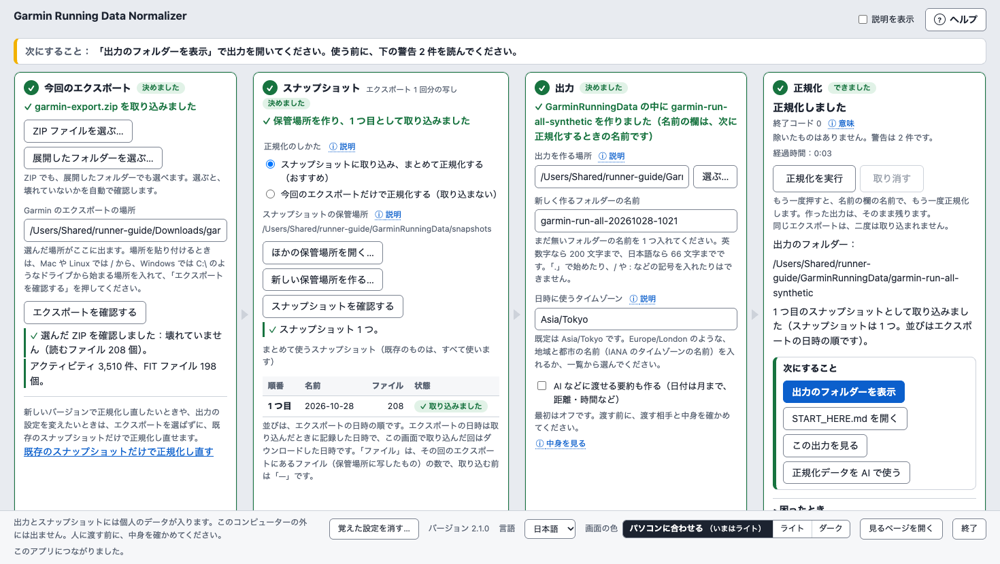

あとから新しいエクスポートを足すときと、ほかの使い方は、[場面ごとの使い方](#場面ごとの使い方)に
あります。

## 用意するもの

- Garmin のエクスポート：Garmin からダウンロードした ZIP か、それを展開した
  フォルダー。手に入れ方は、GUI の画面のヘルプの欄の「使い方」にあります。
  [Getting Started from Garmin Export](getting_started_from_garmin_export.md)（英語）の
  1 と 2 も見てください。Garmin にリクエストしてから、ダウンロードできるように
  なるまでに時間がかかることがあるので、先にリクエストしておいてください。
  このアプリを先に入れて、画面の「使い方」を見てからリクエストしてもかまいません。
- Python 3.11 以降と、このアプリ v2.1.0。どちらも、下の手順で入れます。
  GUI のために、ほかに入れるものはありません。
- 同じコンピューターで動くブラウザ。デスクトップかノートのコンピューターの
  窓で使います。スマートフォンやタブレットには向けていません。
- スナップショットの保管場所と、新しい出力のフォルダーを作るための空き容量。
  保管場所には、エクスポートごとにファイルの写しを置きます（前のエクスポートにも
  あったファイルは、1 つだけ置きます）。

### Python とこのアプリを入れる

この手引きの「ターミナル」は、Windows では PowerShell の窓のことです（行が PS で
始まります）。macOS では、ターミナルのことです。この手引きのコマンドは、そこに
貼って動かします。Windows のコマンドプロンプトでは動きません。

1. Python 3.11 以降が入っているかを確かめます。macOS ではターミナルで
   `python3 --version`、Windows では PowerShell で `py --version` を動かします。
   「Python 3.11.9」や「Python 3.14.0」のように、「3.」のあとの数が 11 以上なら
   使えるので、4 に進みます。「Python 3.9.6」や「Python 3.10.12」のように
   10 以下なら古く、コマンドが見つからないと出るとき（Windows では
   「認識されません」か「is not recognized」）は入っていないので、2 に
   進みます。macOS で、デベロッパ・ツールを入れるかを聞く窓が出たとき
   （ターミナルには `xcode-select` で始まる英語の行が出ます）も、Python は
   入っていません。その窓では入れずに（そこで「インストール」を押さずに）、
   2 に進みます。その窓で入る Python（3.9 など）は、このアプリには古いことが
   あります。もう入れてしまったときは、入り終わってから、`python3 --version` で
   もう一度確かめます。
2. [python.org](https://www.python.org/downloads/) のページから、Python を
   入れます。
   - macOS：「Download Python」のボタンからダウンロードしたファイルを開いて
     入れます。入れ終わったら、[python.org の説明](https://docs.python.org/3/using/mac.html)のとおり、
     開いた Python のフォルダーの窓の「Install Certificates.command」を
     ダブルクリックして、入れるのを終えます（Python が安全なつながりに使う
     証明書を入れます）。ダブルクリックすると、ターミナルの窓が開いて英語の行が
     出ます。終わって止まったら、その窓は閉じてかまいません。Python の
     フォルダーの窓を閉じてしまったときは、Finder の「アプリケーション」の中の、
     「Python 3.14」のような名前のフォルダーにあります。
   - Windows：「Download Python install manager」からダウンロードしたファイルを
     開き、「Install」を押して、Python install manager を入れます。Microsoft Store
     から入れた Python では、このアプリを確かめていません。そのあとは、次の
     どちらかです。
     - まだ Python が 1 つも入っていないとき（1 で「認識されません」と出たとき）：
       新しい PowerShell の窓を開いて、`py --version` を動かします。`py` で
       Python を起動すると、いちばん新しい Python が自動で入ります。途中で、
       `PATH` にフォルダーを足すかを、英語で聞かれることがあります（`PATH` は、
       コマンドを探すフォルダーの一覧です）。下の 1 行は `py` を使うので、
       どちらに答えてもかまいません。
     - 古い Python がもう入っているとき（1 で 3.10 以下と出たとき）：`py` は
       その古い Python を起動するので、PowerShell で `pymanager install default` を
       動かして、いちばん新しい Python を入れます。そのあと、新しい PowerShell の
       窓で `py --version` をもう一度動かします。まだ古い Python が出るときは、
       たいてい、古い Python と一緒に入った Python Launcher が `py` を受け持って
       います。[python.org の説明](https://docs.python.org/3/using/windows.html)のとおり、
       「インストールされているアプリ」で Python Launcher を外し、新しい
       PowerShell の窓でもう一度確かめてください。「インストールされているアプリ」は、
       Windows の設定の「アプリ」の中にあります（Windows 10 では「アプリと機能」）。
       Python install manager と 3.11 以降の Python は残します。
       それでも古い Python が出るときは、3.10 以前の Python も外して、もう一度
       確かめます。古い Python は、ほかのアプリが使っていることもあります。
       外してよいか分からないときは、外さずに知らせてください
       （[GUI を開けないときに知らせる](#gui-を開けないときに知らせる)）。
3. ターミナルを開き直して（Windows では PowerShell の窓を開き直して）、
   もう一度 `python3 --version`（Windows では `py --version`）で
   確かめます。3.11 以降なら、4 に進みます。まだ古いか、見つからないと出る
   ときは、ターミナルの窓をすべて閉じてから（macOS では、メニューの
   「ターミナル」→「ターミナルを終了」で終えてから）開き直して、もう一度
   確かめます。それでも古いときは、Windows では、2 の「古い Python がもう
   入っているとき」の、まだしていない所から続けます。それもすべてしたときや、
   まだ見つからないと出るときや、macOS で古いままのときは、知らせてください
   （[GUI を開けないときに知らせる](#gui-を開けないときに知らせる)）。
4. 下の 1 行を動かします。ホームのフォルダーに仮想環境 `garmin-normalizer` を
   作り、そこに v2.1.0 を入れ、GUI を起動するアイコンを作って
   （[アイコンから起動する](#アイコンから起動する)）、GUI を開きます。
   それぞれの部分は、前の部分がうまくいったときだけ動きます。アイコンを
   作るとき、ターミナルがデスクトップを使ってよいかを macOS が聞くことが
   あります。「許可」を押してください。GUI を使っている間は、ターミナルの窓を
   閉じないでください。1 行は長いので、枠の右上のコピーのボタンで写してから、
   ターミナルに貼ります。

   macOS：

   ```bash
   python3 -m venv ~/garmin-normalizer && ~/garmin-normalizer/bin/python -m pip install garmin-running-data-normalizer==2.1.0 && ~/garmin-normalizer/bin/python -m garmin_running_data_normalizer gui --create-shortcut
   ```

   Windows PowerShell（どのバージョンでも、この 1 行を使えます。バージョン 5.1 には
   `&&` が無いので、`if ($?)` を入れ子にしてつないでいます）：

   ```powershell
   py -m venv "$HOME\garmin-normalizer"; if ($?) { & "$HOME\garmin-normalizer\Scripts\python.exe" -m pip install garmin-running-data-normalizer==2.1.0; if ($?) { & "$HOME\garmin-normalizer\Scripts\python.exe" -m garmin_running_data_normalizer gui --create-shortcut } }
   ```

   - うまくいくと、最後にターミナルに次の 3 行が出て、ブラウザで GUI の画面が
     開きます：「GUI address (it contains the launch key; do not share it):」、
     アドレス、「Stop with Ctrl+C or the Quit button on the page.」。そのあと
     ターミナルは止まって見えますが、GUI が動いているためで、正常です。途中で、
     pip の新しいバージョンがあるという英語の知らせ（A new release of pip is available）が
     出ることがありますが、気にしなくてかまいません。PowerShell の窓で
     アドレスを写すときは、選んでから右クリックで写します。その窓で Ctrl+C を
     押すと、GUI が止まり、実行中の正規化も取り消されることがあります。
   - 途中で止まったとき（エラーの行が出て、画面が開かないまま、次のコマンドを
     入れられる状態に戻ったとき）は、
     [1 行が途中で止まったとき](#1-行が途中で止まったとき)を見て直してから、
     同じ 1 行をもう一度動かしてかまいません。Python を入れる前や、古い Python の
     まま 1 行を動かしたときや、もう一度動かしても同じところで止まるときは、
     ホームのフォルダーにできた `garmin-normalizer` をごみ箱へ入れてから、もう一度
     動かしてください（そのフォルダーが無ければ、そのままでかまいません）。
     ホームのフォルダーの開き方は、この手順のすぐあとにあります。
     `ERROR [SHORTCUT_` で止まったときは、ごみ箱へ入れる要はありません。
   - 新しいバージョンに更新するときは、
     [新しいバージョンに更新するとき](#新しいバージョンに更新するとき)を
     見てください。

Linux にはアイコンが無いので、`--create-shortcut` を外してください。使わなく
なったときの片付けは、[このアプリを片付ける](#このアプリを片付ける)にあります。

ホームのフォルダーは、macOS では Finder のメニューの「移動」→「ホーム」で
開けます。Windows では、エクスプローラーのアドレス欄に `%USERPROFILE%` と
入れて Enter を押すと開けます。Windows 11 のエクスプローラーの左にある
「ホーム」は、このフォルダーではありません。

### 1 行が途中で止まったとき

止まった 1 行は、エラーの行を出して、画面を開かないまま、次のコマンドを
入れられる状態に戻ります（macOS では % で終わる行、Windows では PS で始まる行が、
また出ます）。うまくいって GUI が動いているときは、最後の 3 行を出したまま
止まって見えますが、止まったのではありません。よくある行と、することです。
出た行の中に、表の左の言葉があるかを探してください。

| 出た行（の一部） | よくある理由 | すること |
|---|---|---|
| `command not found`（macOS）、`認識されません` か `is not recognized`（Windows） | Python が入っていないか、入れたあとにターミナルを開き直していません。 | python.org から Python を入れて、ターミナルを開き直してください。 |
| `'&&'` と、`有効なステートメント区切りではありません` か `is not a valid statement separator`（Windows） | macOS の 1 行を Windows PowerShell 5.1 に貼りました。5.1 には `&&` が無いので、PowerShell はこの 1 行を動かしていません。何も変わっていません。 | [用意するもの](#用意するもの)の Windows PowerShell の 1 行を、代わりに動かしてください。ごみ箱へ入れる物はありません。 |
| `xcode-select`（macOS） | Python が入っていないので、macOS がデベロッパ・ツールを入れるかを聞いています。 | その窓では入れずに（そこで「インストール」を押さずに）、python.org から Python を入れて、ターミナルを開き直してください。 |
| `Requires-Python` | Python が古い（3.10 以前）です。 | Python 3.11 以降を入れてターミナルを開き直し、ホームのフォルダーの `garmin-normalizer` をごみ箱へ入れてから、もう一度動かしてください。Windows で古い Python がもう入っているときは、[用意するもの](#用意するもの)の Windows の手順で、`py --version` が 3.11 以降と出るまで進めてください。 |
| `Retrying` と `connection` | インターネットにつながっていません。会社のネットワークの制限のこともあります。 | つながりを確かめてください。会社のコンピューターでは、会社の決まりも確かめてください。 |
| `No matching distribution found`（`Requires-Python` と `Retrying` が無いとき） | Python が古いか（古い pip は `Requires-Python` の行を出しません）、このバージョンが見つかりません。 | `python3 --version`（Windows では `py --version`）で確かめてください。3.10 以前なら、上の `Requires-Python` の行と同じにしてください。3.11 以降なら、手引きの 1 行をコピーして貼り、もう一度動かしてください。 |
| `ERROR [SHORTCUT_` で始まる行 | アイコンを作れませんでした。このアプリは入っています。 | [アイコンを作れなかったとき](#アイコンを作れなかったとき)のコードごとのことをするか、[GUI を起動する](#gui-を起動する)の、macOS か Windows のコマンド（仮想環境の Python で動かすもの）で、アイコンなしで起動してください。 |

直したら、同じ 1 行をもう一度動かしてください。それでも同じところで止まるときは、
ホームのフォルダーの `garmin-normalizer` をごみ箱へ入れてから、もう一度
動かしてください（`ERROR [SHORTCUT_` のときは、その要はありません）。表に無い
行のときや、それでも止まるときは、
[GUI を開けないときに知らせる](#gui-を開けないときに知らせる)のとおりに
知らせてください。

### GUI を開けないときに知らせる

GUI を開けないときや、上の手順で知らせるように書いてあるときは、GitHub の
このアプリのページの
[Issues](https://github.com/tsubotti63/garmin-running-data-normalizer/issues) で
「New issue」を押し、「Bug report」の書式で知らせてください。GitHub の
アカウントが要ります（無料で作れます）。書式の書き方は、
[GitHub で報告する](#github-で報告する)にもあります。GUI が無いときは、
書式の欄に次のように書きます。

- Problem：何が起きたか。
- Guide or command：この手引きのどこか（例：
  [Python とこのアプリを入れる](#python-とこのアプリを入れる)の 4）。
- Operating system：OS とそのバージョン（例：Windows 11。macOS では、
  アップルメニューの「この Mac について」に出ます）。
- Shell：macOS ではターミナル（zsh）、Windows では PowerShell。
- Python version：`python3 --version`（Windows では `py --version`）が
  出した行。
- Package version：`--version` が出した行
  （[新しいバージョンに更新するとき](#新しいバージョンに更新するとき)）。
  このアプリが入る前に止まったときは、入れようとしたバージョン（2.1.0）。
- Sanitized reproduction：動かした 1 行。手引きの 1 行には名前が入っていない
  ので、そのまま貼ってかまいません。
- Exit code：分からなければ、分からないと書きます。
- Does the tracked synthetic fixture reproduce the problem?：「Not tested」を
  選びます。
- Public-safe logs：エラーの行と、そのすぐ前の数行。エラーの行が出ていない
  とき（古い Python を外してよいか分からないときなど）は、
  `python3 --version`（Windows では `py --version`）が出した行と、したことを
  書きます。
- Privacy confirmation：名前の出る所を書き換えてから、4 つのチェックを
  入れます。

行は文字のまま貼り、画面の写しは添付しないでください。貼る前に、名前の出る所を
書き換えます。

- ユーザー名：パス（ファイルやフォルダーの場所）の中の、
  macOS では `/Users`、Windows では `C:\Users` のすぐあとと、
  コマンドの行（macOS では `@` の前など）に出ます。`USER` に書き換えます。
- コンピューターの名前：macOS のコマンドの行の `@` のあとに出ます。
  `COMPUTER` に書き換えます。
- ほかのフォルダーの名前：会社の OneDrive のフォルダーのように、名前が
  入っていることがあります。`FOLDER` に書き換えます。

GUI のアドレスも貼らないでください。起動の鍵が入っています。

### 新しいバージョンに更新するとき

このアプリのバージョンは、画面の下に「バージョン 2.1.0」のように出ます。
ターミナルでは、GUI を動かしている窓とは別の、新しい窓で、次のコマンドを
動かすと分かります。

macOS：

```bash
~/garmin-normalizer/bin/python -m garmin_running_data_normalizer --version
```

Windows PowerShell：

```powershell
& "$HOME\garmin-normalizer\Scripts\python.exe" -m garmin_running_data_normalizer --version
```

このアプリは、新しいバージョンが出ても知らせません。ときどき、GitHub のこのアプリの
ページ（https://github.com/tsubotti63/garmin-running-data-normalizer）を見て
ください。ページの下に出る説明（README）の初めのほうの「Current stable release」に、
いちばん新しいバージョンが書いてあります。
[Releases](https://github.com/tsubotti63/garmin-running-data-normalizer/releases) のページには、出したバージョンが並び、最新のものに
「Latest」が付きます。それが今のバージョンより新しいときに、次のようにします。

1. macOS でも Windows でも、先に GUI を終えてください
   （[GUI を終える](#gui-を終える)）。アイコンから起動したときは、アイコンが
   開いた窓も閉じます。GUI がいくつか開いているときは、すべて終えます。
2. 新しいバージョンの手引きを開き、そのバージョンの手引きにある 1 行を、
   同じように動かします。新しいバージョンの手引きは、GitHub のこのアプリの
   ページ（https://github.com/tsubotti63/garmin-running-data-normalizer）の
   README の初めのほうの「GUI Guide」の横の「日本語」のリンクから開けます。
   1 行は、同じ仮想環境 `garmin-normalizer` に入り、アイコンも作り直します。
3. スナップショットの保管場所・出力・GUI の覚えた設定は、仮想環境の外に
   あるので、そのまま残ります。

2.2.0 から前のバージョン（2.1.0 など）に戻したときは、2.2.0 が覚えた設定は
使われず、初めての起動として始まります。設定のファイルは書き換えません。戻した
バージョンで「覚えた設定を消す…」を押すと、2.2.0 が覚えたもの（タイムゾーンや、
見るページで覚えたものなど）も消えます。見るページの印のファイル `gui-marks.json` は
消えずに、設定のフォルダーに残ります。2.2.0 の「覚えた設定を消す…」で消えます。
2.2.0 に戻さずにこのアプリを片付けるときは、設定のフォルダーごと消してください。

GUI を開いたまま 1 行を動かすと、前の GUI は動いたまま残り、GUI がもう 1 つ
開きます。Windows では、途中で「Unable to copy」で始まる英語の行も出ます。
使っている Python を写し直せなかった、という知らせで、1 行はそのまま進みます。
前の GUI のページは前のバージョンのままですが、そこで正規化すると、正規化だけが
新しいバージョンで動くので、バージョンが混ざります。こうなったときは、開いている
GUI をすべて終えてから、同じ 1 行をもう一度動かしてください。

## 場面ごとの使い方

よくある 8 つの場面の手順です。箱ごとの細かいことは、リンク先の節にあります。
スナップショットは、エクスポート 1 回分の写しで、保管場所に置きます。取り込んだ
エクスポートは、まとめて正規化します（[2 の箱](#2-の箱スナップショット)）。

### 初めて正規化する

こんなとき：Garmin からエクスポートの ZIP をダウンロードした。このアプリを
初めて使う。

1. [GUI を起動します](#gui-を起動する)。このアプリを入れた直後は、
   入れたときの 1 行が、GUI をもう開いています。
2. 1 の箱の「ZIP ファイルを選ぶ…」を押して、ダウンロードした ZIP を、展開せずに
   選びます。ブラウザがもう展開していたときは、そのフォルダーを
   「展開したフォルダーを選ぶ…」で選びます。確認が済むと、1 の箱が緑になります。
3. 2 の箱で「この内容で決める」を押します。3 の箱では、「日時に使うタイムゾーン」を
   確かめてから（既定は `Asia/Tokyo`）、「この内容で決める」を押します。
4. 4 の箱の「正規化を実行」を押します。「正規化しました」と出たら、「次にすること」の
   「この出力を見る」で、見るページが開きます。出力の説明は、「START_HERE.md を開く」で
   読めます。

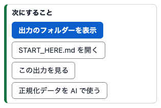

くわしくは：[1 の箱](#1-の箱今回のエクスポート)・[2 の箱](#2-の箱スナップショット)・[3 の箱](#3-の箱出力)・[4 の箱](#4-の箱正規化)

### 新しいエクスポートを足す（2 回目から）

こんなとき：何か月かたって、新しいエクスポートをダウンロードした。

1. [GUI を起動します](#gui-を起動する)。2 の箱と 3 の箱には、前回の保管場所と
   出力を作る場所が出ています。
2. 1 の箱で、新しい ZIP を選びます。確認が済むと、覚えていた場所が見つかれば、
   2 の箱と 3 の箱は自動で決まります（[2 回目からの起動](#2-回目からの起動)）。
   決まらなかった箱は、「この内容で決める」を押して決めます。
3. タイムゾーンは、前に出力を作った正規化のものを覚えています（2.2.0 から）。
   3 の箱の要約で確かめます。変えるときは、3 の箱で選び直して、
   「この内容で決める」を押します。
4. 4 の箱の「正規化を実行」を押します。前に取り込んだ分と合わせた出力が、新しい
   フォルダーにできます。前の出力は、そのまま残ります。

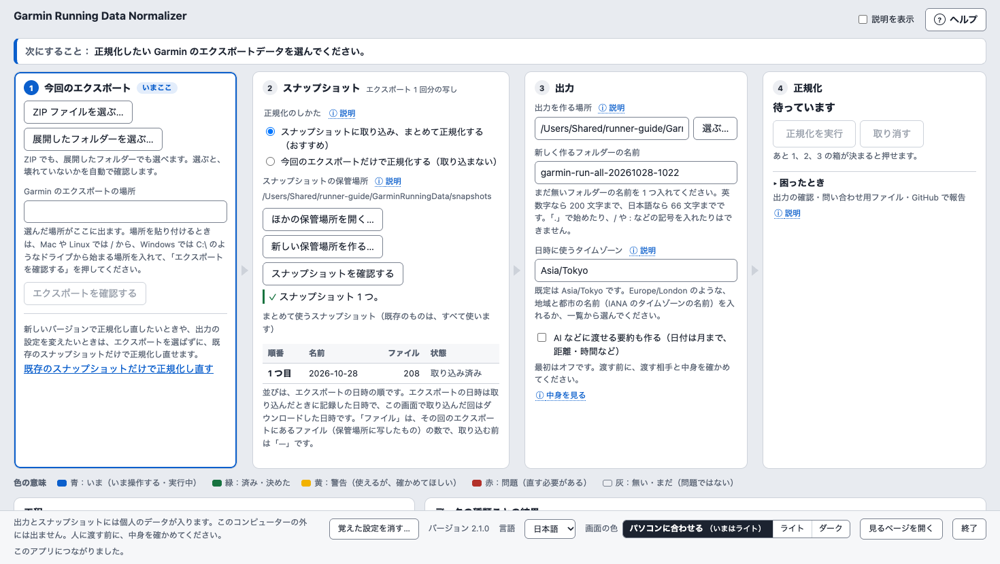

くわしくは：[2 回目からの起動](#2-回目からの起動)・[2 の箱](#2-の箱スナップショット)

### 取り込まずに、試しに正規化する

こんなとき：スナップショットに取り込まずに、今回のエクスポートだけで試したい。

1. [GUI を起動し](#gui-を起動する)、1 の箱でエクスポートを選びます。
2. 2 の箱の「正規化のしかた」で「今回のエクスポートだけで正規化する（取り込まない）」を
   選び、「この内容で決める」を押します。保管場所は使いません。
3. 3 の箱で「この内容で決める」を、4 の箱で「正規化を実行」を押します。

正規化のしかたは覚えません。次の起動では、2 の箱は取り込むほうに戻ります。

くわしくは：[2 の箱](#2-の箱スナップショット)

### 新しいバージョンにしたあと、正規化し直す

こんなとき：このアプリを新しいバージョンに更新する。見るページは、使っている
バージョンで作った出力だけを開く（小さな更新のあとも同じ）ので、前の出力は
開けない。前の出力は、そのまま残る。

1. [新しいバージョンに更新して](#新しいバージョンに更新するとき)から、
   [GUI を起動します](#gui-を起動する)。
2. スナップショットに取り込んでいたときは、1 の箱のいちばん下の
   「既存のスナップショットだけで正規化し直す」を押します。エクスポートは
   選びません。取り込んでいなかったときは、もとのエクスポートを 1 の箱で選び、
   2 の箱で「今回のエクスポートだけで正規化する（取り込まない）」をもう一度選びます
   （正規化のしかたは覚えません）。
3. 2 の箱と 3 の箱が決まっていなければ、「この内容で決める」を押して決めます。
4. 4 の箱の「正規化を実行」を押します。新しいバージョンの出力が、新しいフォルダーに
   できます。「この出力を見る」で、見るページに開けます。

くわしくは：[1 の箱](#1-の箱今回のエクスポート)・[見るページを開く](#見るページを開く)

### 見るページで、直近 1 年を月ごとに見る

こんなとき：この 1 年の、月ごとの距離や安静時心拍数を見たい。

1. [見るページを開きます](#見るページを開く)。
2. 上の「期間」で「1 年」を、「まとめ方」で「月」を押します。全部の段に効きます。
3. その前の 1 年は、期間の横の ‹ を押すと見られます。

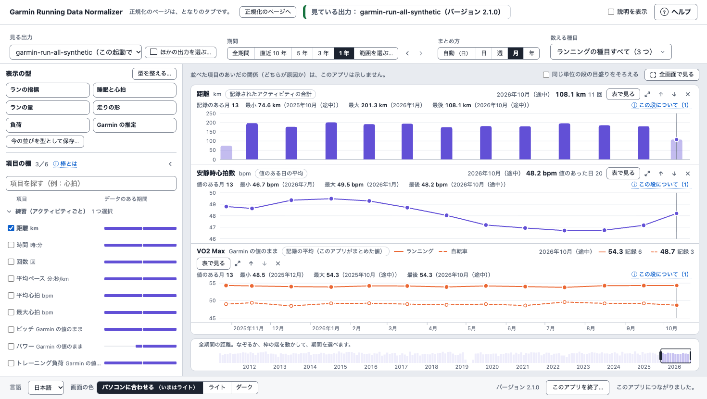

くわしくは：[期間・まとめ方・数える種目](#期間まとめ方数える種目)

### 毎年の 5 月をくらべる

こんなとき：毎年 5 月の距離を、年ごとに並べてくらべたい。

1. [見るページを開きます](#見るページを開く)。
2. 「距離」の段の見出しの「年でくらべる」を押します。
3. 帯の「見せ方」で「年ごとに並べる」を、「月」で「5月」を選びます。毎年の 5 月が、
   1 年 1 段で縦に並びます。
4. 数字で見るときは「表で見る」を押します。

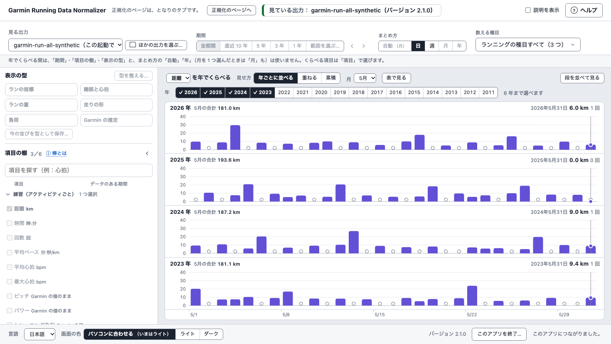

くわしくは：[年でくらべる](#年でくらべる220-から)

### 大会の前の 16 週をくらべる

こんなとき：いくつかの大会の前の 16 週の距離を、大会ごとに並べてくらべたい。

1. [見るページを開きます](#見るページを開く)。
2. 段の上の「印…」で、大会の印を 2 つ以上足します（例：種類「大会」、名前
   「春のマラソン」、日付 2026-03-15）。
3. 「距離」の段の見出しの「年でくらべる」を押し、帯の題の「大会の日」を押します。
4. 「見せ方」で「大会ごとに並べる」を、「範囲」で「16 週前から大会の日まで」を選びます
   （見せ方と範囲は、前に選んだものを覚えています）。新しい大会が 4 つまで、大会ごとに
   並びます。
5. 数字で見るときは「表で見る」を押します。

くわしくは：[大会の日でくらべる](#大会の日でくらべる)、[印](#印220-から)

### 数字を CSV にして、AI に渡す

こんなとき：見るページの数字を、表計算のアプリや AI に渡したい。

1. GUI を動かしている窓とは別の、新しいターミナルの窓で、`series` の 1 行を
   動かします。1 行は、[同じ数字を CSV に書く（コマンドライン）](#同じ数字を-csv-に書くコマンドライン)に
   あります。例の場所は、自分の場所に置き換えます。
2. CSV には、あなたの個人のデータが入っています。渡す前に、渡す相手と中身を
   確かめてください。
3. CSV と一緒に、ターミナルに出た `about` で始まる行も渡します。値の無い記録など、
   数字に入らなかったものの数です。

出力そのものを AI で使うときは、4 の箱の「次にすること」の
「正規化データを AI で使う」から始めます。外の AI に渡す要約は、
[3 の箱](#3-の箱出力)で、正規化のときに一緒に作れます。

くわしくは：[同じ数字を CSV に書く（コマンドライン）](#同じ数字を-csv-に書くコマンドライン)

## GUI を起動する

[用意するもの](#用意するもの)の 1 行で入れたときは、このアプリはその仮想環境の
中にあります。アイコン（[アイコンから起動する](#アイコンから起動する)）を
ダブルクリックするか、アイコンと同じく仮想環境の Python で、次のコマンドを
動かしてください。

macOS：

```bash
~/garmin-normalizer/bin/python -m garmin_running_data_normalizer gui
```

Windows PowerShell：

```powershell
& "$HOME\garmin-normalizer\Scripts\python.exe" -m garmin_running_data_normalizer gui
```

ほかのしかたで入れて、`garmin-running-data-normalizer` のコマンドが使えるときは
（仮想環境を有効にしたときなど）、次のコマンドでも起動できます。
手引きの 1 行で入れただけでは、このコマンドは使えません。

```bash
garmin-running-data-normalizer gui
```

コマンドは、GUI のアドレスをターミナルに表示し、既定のブラウザで開きます。
`--no-browser` を付けると、アドレスを表示するだけで、ブラウザは開きません。

- アドレスには、この起動だけの鍵が入っています。人に渡さないでください。
  鍵の無いページからは、GUI を使えません。画面にそう出たときは、
  ターミナルに表示されたアドレスを開いてください。
- GUI を使っている間は、ターミナルを閉じないでください。GUI は、ブラウザの
  1 つのタブで使ってください。
- 画面の言語は、ブラウザの言語に合わせます。画面の下の帯の「言語」で、
  英語と日本語を切り替えられます。選んだ言語は、そのタブの中だけで覚えます。
- 画面の下の帯（「言語」と「終了」のある帯）は、ページを上下に動かしても、
  ブラウザの窓の下に見えたままです。
- 下の帯の「画面の色」で、画面の色を選べます（[画面の色](#画面の色)）。
  「見るページを開く」は、見るページを開きます
  （[見るページ（2.1.0 から）](#見るページ210-から)）。

画面には、決めていく順に番号の付いた 4 つの箱があります：1「今回のエクスポート」、
2「スナップショット」、3「出力」、4「正規化」。上の「次にすること：」の行が
いますることを出し、いま操作する箱には「いまここ」が付きます。2 と 3 の箱は
「この内容で決める」で決めます。いま操作する箱では、次に押すボタンとして、
このボタンが青く塗られています。決めた箱には「決めました」が付き、その箱で
正規化が何をするかを 1 行で出します。箱の下には、画面の色の意味を出す
「色の意味」と、2 つの表があります：正規化の工程とそれぞれの時間を出す「工程」と、
「データの種類ごとの結果」です。

## アイコンから起動する

macOS と Windows では、`--create-shortcut` を付けると、GUI を起動するアイコンを
作ってから、付けないときと同じように GUI を開きます。[用意するもの](#用意するもの)の
1 行も、こうしてアイコンを作ります。アイコンを作り直すとき（Python や仮想環境を
入れ替えたとき、アイコンをごみ箱へ入れてしまったときなど）は、1 行で入れたなら、
仮想環境の Python で次のコマンドを動かしてください。

macOS：

```bash
~/garmin-normalizer/bin/python -m garmin_running_data_normalizer gui --create-shortcut
```

Windows PowerShell：

```powershell
& "$HOME\garmin-normalizer\Scripts\python.exe" -m garmin_running_data_normalizer gui --create-shortcut
```

`garmin-running-data-normalizer` のコマンドが使えるときは、次のコマンドでも
作れます。

```bash
garmin-running-data-normalizer gui --create-shortcut
```

- macOS：デスクトップに「Garmin Running Data Normalizer.command」ができます。
  このアプリの絵（GR と DN を 2 段に重ねた青いタイル）が付き、名前は「.command」を
  除いて出ます。Finder の設定の「詳細」で「すべてのファイル名拡張子を表示」を
  オンにしているときは、「.command」も出ます。動きは同じです。
  ダブルクリックすると、ターミナルの窓が開いてアドレスを表示し、既定の
  ブラウザで GUI を開きます。コマンドがファイルを書くとき、ターミナルが
  デスクトップを使ってよいかを macOS が聞くことがあります。「許可」を
  押してください。許可しないと、アイコンは作られません。「許可しない」を
  押したあとは、macOS はもう聞きません。システム設定の
  「プライバシーとセキュリティ」→「ファイルとフォルダ」で、「ターミナル」の
  「デスクトップフォルダ」をオンにしてから、アイコンを作るコマンドをもう一度
  動かしてください。そのあと、選ぶフォルダー（ダウンロードなど）についても、
  ターミナルから起動したときと同じように macOS が聞きます。
- Windows：デスクトップとスタートメニューに、ショートカット
  「Garmin Running Data Normalizer」ができ、同じ絵が付きます。ショートカットから
  起動すると、窓は最小化されて、タスクバーに入ります。
- ブラウザのタブにも、同じ絵が出ます。
- アイコンに絵を付けられなかったときは、コマンドが「The picture of the icon
  could not be set; the icon still starts the GUI.」と出して、そのまま続けます。
  アイコンは、ふつうのファイルの見た目のまま GUI を起動します。
- GUI を使っている間は、アイコンが開いた窓を閉じないでください。閉じると、
  ターミナルを閉じたときと同じく GUI が止まります。
- アイコンは、このコマンドを動かした Python を起動します。新しいバージョンに
  更新したあとは（[新しいバージョンに更新するとき](#新しいバージョンに更新するとき)）、
  アイコンから新しいバージョンが起動します。Python（例：3.13 から
  3.14）や仮想環境を入れ替えたときは、もう一度このコマンドでアイコンを作り直して
  ください。アイコンに鍵は入りません（起動のたびに作ります）。
- このコマンドは、このコマンドが作ったアイコンだけを置き換えます。アイコンを
  作れないときは、`ERROR [SHORTCUT_` で始まる行を出して止まります
  （[アイコンを作れなかったとき](#アイコンを作れなかったとき)）。
- デスクトップを iCloud や OneDrive で同期していると、ほかのコンピューターにも
  アイコンが写ります。そこでは Python の場所が違うので、起動できないことが
  あります。絵が写らないこともあります。
- アイコンが要らなくなったら、ごみ箱へ入れてください（Windows では、
  スタートメニューの分も。[このアプリを片付ける](#このアプリを片付ける)）。
  `pip uninstall` では消えません。
- Linux にはアイコンがありません。コマンドで起動してください。

### アイコンを作れなかったとき

アイコンを作れないときは、アイコンを作るコマンドは `ERROR [SHORTCUT_` で
始まる行を出して止まり、GUI は開きません。そのときも、このアプリは入って
います。[GUI を起動する](#gui-を起動する)の、仮想環境の Python のコマンド
（`--create-shortcut` なし）で、GUI を開けます。アイコンを作るには、行の
コードごとに次のようにしてから、上のアイコンを作るコマンドをもう一度動かします
（手引きの 1 行でも作れます）。

- `SHORTCUT_PLACE_TAKEN`：このアプリが作っていないファイルが、アイコンと
  同じ名前でデスクトップにあります（Windows では、デスクトップか
  スタートメニュー。スタートメニューの分は、エクスプローラーのアドレス欄に
  `shell:programs` と入れて開くフォルダーの中にあります）。アイコンの名前は
  「Garmin Running Data Normalizer」です（macOS では「.command」が付きます）。
  そのファイルの名前を変えるか、移すか、要らなければごみ箱へ入れてください。
- `SHORTCUT_NOT_CREATED`：アイコンを書けませんでした。macOS では、ターミナルが
  デスクトップを使えません。上の macOS の項目の「許可しない」を押したあとの
  とおりにしてください。Windows では、このアプリがショートカットを作るのに
  使う Windows PowerShell が、ショートカットを作れませんでした。どちらでも、
  もう一度動かしてまた止まるときは、知らせてください
  （[GUI を開けないときに知らせる](#gui-を開けないときに知らせる)）。
- `SHORTCUT_NOT_SUPPORTED`：アイコンは macOS と Windows だけです。
  `--create-shortcut` を付けずに起動してください。

## 開いている GUI に戻る

- ブラウザのタブを閉じても、GUI はすぐには止まりません。実行中の正規化も、
  最後まで動きます。戻るには、次のどちらかにします。実行中かどうか分からない
  ときは、アドレスのほうにします。
  - ターミナルに出ているアドレスを写して、ブラウザのアドレス欄に貼ります。
    実行中の正規化があれば、そのページに出ます。アドレスは長いので、端から端まで
    選びます。「このページからは、このアプリを使えません。」と出たときは、
    アドレスを端から端までもう一度写します。macOS のターミナルでは、
    アドレスを選んで command キーと C で写します。control キーと C を押すと、
    GUI が止まり、実行中の正規化も取り消されます。Windows の窓では、アドレスを
    選んでから右クリックで写します。Windows の窓で Ctrl+C を押すと、GUI が
    止まり、実行中の正規化も取り消されることがあります。アイコンから起動した
    ときは、アイコンが開いた窓がターミナルです（Windows では、最小化されて
    タスクバーに入っています）。
  - 実行中の正規化が無いときは、代わりにアイコンをもう一度ダブルクリック
    してもかまいません。こちらのほうがかんたんです。新しい GUI が開くので、
    そのページを使います。前の GUI でしていることは出ません。1 の箱から選び
    直します。前の GUI は、ページが無いので、実行中でなければ、60 分たつと
    自分で止まります。
- 前の GUI が止まったあとは、そのアドレスを貼っても開けません。アイコンか、
  起動のコマンドで、もう一度起動してください。
- ブックマークからは開けません。ブラウザの履歴からも開けません。ページは
  アドレスから鍵を外し、鍵は起動のたびに変わるためです。
- アイコンをもう一度ダブルクリックしたり、起動のコマンドをもう一度動かしたり
  すると、GUI がもう 1 つ開きます。使うのは 1 つにしてください（実行中の
  正規化があるときは、その GUI を使います）。使わない GUI は、そのページの
  「終了」で終えます（問いには「終了する」と答えます）。どちらかのページで
  「終了」を押すと、そのページの GUI だけが終わります。ページを閉じた GUI は、
  実行中でなければ、60 分たつと自分で止まります。前の GUI がまだ正規化している
  あいだに、新しい GUI が、保管場所に目印のファイルがある
  （`SNAPSHOT_STORE_LOCKED`）と出すことがあります。その正規化が終わるまでは、
  ✓ を入れて「目印のファイルを消す」を押さないでください。そのときは、
  新しい GUI を「終了」で終えて、前の GUI に、そのアドレスから戻ります。
- ページを開いているあいだは、ページが GUI に知らせを送るので、操作しなくても
  GUI は止まりません。ブラウザが、使っていないタブを眠らせたときや、窓を
  隠したとき（Safari の ⌘H など）は、止まることがあります。どのページも
  開いていないまま 60 分たつと、実行中でなければ、GUI は自分で止まります。ターミナルの窓を閉じたときも止まります。
  止まると、ターミナルに「GUI stopped.」と出ます（Windows でアイコンから
  起動したときは、窓が自分で閉じます）。
- 画面に「このアプリが応答しません」と出たときは、GUI が止まっているかも
  しれません。アイコンをもう一度ダブルクリックするか、同じコマンドで起動し
  直してください。新しいアドレスでページが開きます。古いタブは閉じて
  かまいません（[うまくいかないとき](#うまくいかないとき)）。

## 1 の箱：今回のエクスポート

1. Garmin からダウンロードした ZIP なら「ZIP ファイルを選ぶ…」、それを展開した
   フォルダーなら「展開したフォルダーを選ぶ…」を押します。ZIP は、展開しないで
   そのまま使えます。OS の選ぶ窓が開きます。OS に選ぶ窓が無いときは、代わりに
   画面の中の一覧が開きます。一覧には、フォルダーと ZIP ファイルが出ます。
   隠したものとリンクは出ません。フォルダーを押すとその中を開き、ZIP ファイルか
   「このフォルダーにする」を押すと、それを選びます。
2. 選ぶと、すぐに確認します。これは `doctor --input` のコマンドと同じ確認です。
   まず赤で正規化を始められない理由を、次に黄色で始められるが知らせること
   （読めずに除くファイルなど）を、最後に緑で正規化できることと、アクティビティと
   FIT ファイルの数を出します。大きなエクスポートでは、確認に時間がかかります。
   エクスポートにどの種類のデータがあるかは、正規化してはじめて分かり、
   「データの種類ごとの結果」に出ます。
3. 展開したフォルダーのときは、展開が最後まで終わったことを確かめて、
   「ZIP の展開が最後まで終わり、欠けていないことを確かめた」に ✓ を入れます。
   展開が途中だと、ファイルが欠けたまま正規化され、結果が変わるためです。
   ZIP のときは要りません。ZIP は、最後までそろっていて壊れていないかを、
   このアプリが確かめます。

「Garmin のエクスポートの場所」にフルパスを貼り付けて、「エクスポートを確認する」を
押すこともできます。貼り付けた場所の前後の空白は除きます。場所を変えると、
確認の結果は消えます。始める前に、もう一度確認してください。

選んだフォルダーに、2 つ以上のエクスポートか、違うアカウントのエクスポートが
あるときは、フォルダーの中の場所でそれぞれを示し（同じ中身のものは 1 つと
数えます）、それぞれを選ぶボタンを出します。選ぶと、そのエクスポートを確認します。

2 の箱でスナップショットに取り込むとき（既定）は、この箱で、取り込みの値を
2 つ確かめます。

- 「スナップショットの名前」：既定は、ダウンロードした日です。保管場所に
  同じ名前があれば、`-2`・`-3` などを付けます。英数字と . _ - で 64 文字までで、
  英数字で始めます。日本語は使えません。
- 「ダウンロードした日時」：ZIP ならファイルの日時を、展開したフォルダーなら
  中のいちばん新しいファイルの日時（エクスポートが作られた日時に近い）を、
  自動で入れます。どちらから入れたかは、下の行に出ます。このコンピューターの
  時刻で、`2030-01-01 02:00` のように書きます。スナップショットの順番は
  この日時の順なので、ほかの回との前後が実際と違うときだけ直してください。

どちらも、正規化を始める前に確かめます。この 2 つは次の取り込みのための
ものなので、正規化が終わると、何かを変えるまで隠します。名前や日時のために
正規化を始められないあいだは、理由と一緒に出します。

保管場所にスナップショットがあるときは、箱のいちばん下の
「既存のスナップショットだけで正規化し直す」で、エクスポートを選ばずに
正規化し直せます。新しいバージョンのこのアプリで正規化し直したいときや、
出力の設定を変えたいときに使います。このとき箱はエクスポートを使いません。
「やめて、エクスポートを選ぶ」で戻ります。

## 2 の箱：スナップショット

スナップショットは、エクスポート 1 回分の写しです。スナップショットの保管場所は、
スナップショットを入れておくフォルダーです。スナップショットで正規化するたびに、
保管場所にある全部のスナップショットをまとめて使うので、前のエクスポートに
あった分も出力に入ります。どれかを外すことはできません。

「正規化のしかた」は、2 つから選びます。

- 「スナップショットに取り込み、まとめて正規化する（おすすめ）」：今回の
  エクスポートを保管場所に写してから、既存のスナップショットと合わせて
  正規化します。
- 「今回のエクスポートだけで正規化する（取り込まない）」：保管場所を使わず、
  今回のエクスポートだけで正規化します。保管場所の部分は灰色になり、
  「このしかたでは、保管場所は使いません。今回のエクスポートだけで正規化し、
  スナップショットには取り込みません。」と出ます。このしかたでは、保管場所は
  作りません。

3 つ目のしかたの、既存のスナップショットだけで正規化し直すことは、1 の箱で
選びます。

「スナップショットの保管場所」の既定は、ホームのフォルダーの中の
`GarminRunningData` の `snapshots` です。初めての起動では、そこにある保管場所を
開くか、保管場所がまだ無く、正規化するときにそこに作ることを出します。

- 「使っている保管場所を開く…」は、もう使っている保管場所（コマンドラインで
  作ったものなど）を開きます。選んだフォルダーの中の `snapshots` にある
  保管場所も開けます。
- 「作る場所を選ぶ…」は、新しい保管場所を作るフォルダーを選びます。保管場所は、
  その中の `snapshots` に作ります（選んだフォルダーの名前が `snapshots` なら、
  そのフォルダー自体）。そこにもう保管場所があれば、それを開きます。
  正規化で取り込むまでは、何も作りません。
- 保管場所を開いたあとは、「ほかの保管場所を開く…」と「新しい保管場所を作る…」で
  同じことができ、「スナップショットを確認する」で、`snapshot verify` の
  コマンドと同じ確認をします。

どのボタンも、OS のフォルダーを選ぶ窓（無いときは画面の中のフォルダーの一覧）を
開きます。iCloud Drive や OneDrive、Mac の「書類」とデスクトップなど、
クラウドに写すことのあるフォルダーの中の保管場所は、黄色で知らせます。

スナップショットの一覧には、正規化で使う全部のスナップショットが、
エクスポートの日時の順に、それぞれのファイルの数と一緒に出ます。今回取り込む
エクスポートは、日時の順の場所に「今回取り込む」として入り、正規化のあとは
「取り込みました」になります。ほかは「取り込み済み」です。保管場所の
スナップショットと同じ中身のエクスポートなら、取り込むときにそれが分かり、
新しい回は増やしません。結果に、どのスナップショットと同じだったかが出ます。

「この内容で決める」を押して、この箱を決めます。

保管場所には、個人のデータが入ります。このアプリは、取り込んだスナップショットの
ファイルを書き換えず、自動で消すこともしません。保管場所は、このコンピューターの
中の、自分だけが読める場所に置き、Time Machine などでバックアップを取って
ください。取る前に「スナップショットを確認する」で問題が無いことを確かめ、
戻したあとも、もう一度確かめてください。

取り込みが途中で止まったとき（コンピューターの電源が切れたときなど）は、
保管場所に目印のファイル `.single-writer.lock` が残り、次の取り込みは
`SNAPSHOT_STORE_LOCKED` で止まります。箱には、目印のファイルがどれくらい前に
作られたかが出ます。1 分以内に作られたものは、動いている取り込みのものかも
しれません。ほかに正規化やスナップショットのコマンド（ターミナルや別のタブ）が
動いていなければ、
「ほかに正規化やスナップショットのコマンドが動いていないことを確かめた」に
✓ を入れて、「目印のファイルを消す」を押します。消すのはこのファイルだけで、
スナップショットは消えません。そのあと「正規化を実行」を押すと、取り込み直します。

Windows では、保管場所を短いパスの場所に置いてください。長いパスを有効にして
いない Windows では、パス全体が 260 文字までです。保管場所の中のファイルは、
保管場所のパスに 190 文字ほど足されるので、保管場所のパスは 70 文字ほどまでに
なります。画面は、保管場所を作る場所を選んだときと取り込みの前にこれを確かめ、
コマンドの `snapshot init`・`snapshot register` と同じく
`SNAPSHOT_STORE_PATH_TOO_LONG` で止めます。開いてある保管場所なら、取り込む
ときに箱が赤で知らせます。既定の場所なら、ふつうは長すぎることはありません。

## 3 の箱：出力

- 「出力を作る場所」：既定は、ホームのフォルダーの中の `GarminRunningData` です。
  無ければ、正規化するときに作ります。出力は、その中に新しいフォルダーとして
  作ります。「選ぶ…」で、OS のフォルダーを選ぶ窓（無いときはフォルダーの名前の
  一覧）から、ほかのフォルダーを選べます。ほかのフォルダーは、すでにあって、
  このアプリが書き込めることが必要です。GUI は、正規化を始める前に書き込めるかを
  確かめます。クラウドに写すことのあるフォルダーは、保管場所と同じく黄色で
  知らせます。
- 「新しく作るフォルダーの名前」：`garmin-run-all-YYYYMMDD-HHMM`
  （年月日と時分）の形で、案が入ります。同じ名前のフォルダーがすでにあれば、
  `-2`・`-3` などを付けた名前にします。まだ無い名前にしてください。
  英数字なら 200 文字まで、日本語なら 66 文字までです。「.」で始めたり、
  `/` や `:` などの記号を入れたりはできません。自分で入れた名前のフォルダーが
  すでにあるときは、正規化を始める前に赤で知らせます。
- 「日時に使うタイムゾーン」：既定は `Asia/Tokyo` です。`Europe/London` の
  ような IANA の名前を入れるか、一覧から選んでください。ふつうは、住んでいる所の
  タイムゾーンです（日本なら、既定のままです）。1 回の正規化では、1 つの
  タイムゾーンで日付と時刻を出すので、旅先の記録も、その土地の時刻にはなりません。
  タイムゾーンを変えると、日付をまたぐ記録（睡眠など）の日がずれることが
  あります。前の出力と比べるときは、同じタイムゾーンにそろえてください。
- 「AI などに渡せる要約も作る（日付は月まで、距離・時間など）」：最初はオフです。
  コマンドラインの `--external-safe-pack`（External-safe Pack）と同じもので、
  出力のフォルダーの中の `analysis/external_safe_handoff.zip` という 1 つの ZIP に、
  アクティビティ 1 件につき 1 行の表が入ります。列は 6 つで、月、アクティビティの
  種類、スポーツの種類、距離、時間、ラップ数です。入るものと入らないものは
  「中身を見る」に出ます。渡す前に、中身を確かめてください。正規化のあとは、
  作ったファイルの名前が出て、「保存した場所を表示」でフォルダーの中に
  表示できます。

「この内容で決める」を押して、この箱を決めます。

Windows では、出力の場所と名前を短めにしてください。長いパスを有効にしていない
Windows では、パス全体が 260 文字までです。出力の中のファイルは、出力の
フォルダーのパスに、40 文字ほど足されます。パスが長すぎるときは、正規化を
始める前に、GUI がそう知らせます。

出力のフォルダーは、正規化が終わったときにはじめてできます。それまで正規化は、
その隣の、隠れた作業用のフォルダーで作業します。

## 4 の箱：正規化

「正規化を実行」は、前の箱が決まると押せます。それまでは、ボタンの下に、
あとどの箱を決めるかが出ます。同時に実行できるのは 1 つだけです。

- 箱には、いまの工程とその番号、経過時間が出ます。「工程」の表には、工程ごとの
  時間が出ます。FIT ファイルを読んでいる間は、読んだ件数が棒で出ます。中身が
  同じファイルは 1 回だけ読みます。30 秒進まないときは、そのことが出ます。
  大きなエクスポートでは時間がかかるので、そのまま待てます。
- ターミナルは閉じないでください。ブラウザのタブや窓を閉じても、正規化は
  続きます。同じアドレスを開き直すと、続きが見られます。コンピューターが
  眠っているあいだは、正規化は進みません。
- 「取り消す」は、箱の中で先に聞きます：「正規化を取り消す」か「続ける」。
  終わる前に取り消した正規化は、出力のフォルダーを作りません。取り込みの途中
  だったときは、保管場所は次の取り込みでそろいます。取り消しが間に合わずに
  終わったときは、出力を残し、画面にそう出します。使う前に `START_HERE.md` を
  読むか、要らなければ出力のフォルダーを消してください（自動では消しません）。
- 強く止めたために、隠れた作業用のフォルダー（`.<名前>.run-all-…`）が
  出力の場所に残ったときは、画面にその名前が出ます。実行中でないことを
  確かめてから消してください。

箱の見出しには、どう終わったかが出て、その下に、同じ結果のときにコマンドラインが
返す終了コードが出ます。「意味」で、コードの意味を見られます。

| 結果 | 終了コード | 意味 |
|---|---|---|
| `PASS` | 0 | 「正規化しました」：警告なしで終わりました |
| `PASS_WITH_WARNINGS` | 0 | 「正規化しました」：終わりました。警告を確かめてから、出力を使えます |
| `PARTIAL_SUCCESS` | 3 | 「一部を除いて正規化しました」：読めなかったファイルや、なくてはならない値の無い行など、除いたものがあります。出力は使えます |
| 止まった | 2 | 「正規化できませんでした」：出力のフォルダーは作っていません。問題のある箱に、理由と次にすることが出ます |

取り込んだときは、エクスポートがスナップショットの順番の何番目に入ったか、
または保管場所にもう同じエクスポートがあったので新しい回を増やしていないことも、
箱に出ます。取り込みのあとで止まった正規化でも、取り込みは済んでいます。
もう一度「正規化を実行」を押すと、同じエクスポートは新しい回にせずに
正規化します。

「データの種類ごとの結果」には、データの種類ごとに、件数・状態・警告の数が
出ます。最後に、どの種類にも入らない警告の行と、警告の合計の行があります。
黄色の行は警告です。「エクスポートに無い」の種類のうち、ギア・自己ベスト・FIT ファイルは
警告になります。日ごとの記録（睡眠・HRV・VO2max など）は、入っていないことがよくあるので、
警告になりません。

「出力の確認」は、正規化のあとに自動で行い、「工程」の表の下に出ます。
`validate-handoff` と `doctor --run-output` のコマンドと同じ確認です。次のことを
出します。

- 合格したかと、データセットの数、データどうしのつながりの数
- 出力を使えるかどうかと、次にすること
- 正規化の警告：その合計と、1 件ずつの関わるデータ・数・コード

「次にすること」の「出力のフォルダーを表示」は、macOS では Finder で、Windows では
エクスプローラーで、Linux では `xdg-open` が選ぶファイルのアプリで、
フォルダーを表示します。「START_HERE.md を開く」は、`.md` のファイルの
既定のアプリで開きます。出力は `START_HERE.md` から読み始めてください。
出力の読み方と、除いたもの・警告の説明が書いてあります。
「正規化データを AI で使う」は、ヘルプの欄の、出力を AI で使う部分を開きます。
「この出力を見る」は、となりのタブの見るページで、この出力を開きます
（[見るページ（2.1.0 から）](#見るページ210-から)）。

正規化のあとは、次の正規化のための新しい名前の案が入ります。「正規化を実行」の
下には、もう一度押したときのことが「もう一度押すと、名前の欄の名前で、もう一度
正規化します。作った出力は、そのまま残ります。」と出ます。名前の欄は、3 の箱の
「新しく作るフォルダーの名前」です。タイムゾーンなどの設定を変えたときに、
もう一度押します。同じ入力と設定なら、同じ中身の出力がもう 1 つできるだけです。
取り込んだときは、「同じエクスポートは、二度は取り込まれません。」も出ます。
今回のエクスポートは、保管場所に 1 回だけ入り、次の正規化にも使われます。

## 見るページ（2.1.0 から）

見るページは、正規化した出力の数字を、時間の軸をそろえたグラフで見るページです。
正規化のページのとなりのタブに開きます。項目 1 つぶんのグラフを「段」と呼び、
段を上から並べます。このアプリのこのバージョンで作った出力だけを見られます。
数字は外へ送りません。並べた項目のあいだの関係（どちらが原因か）や、何をすれば
よいかは示しません。自分の目で見るための画面です。

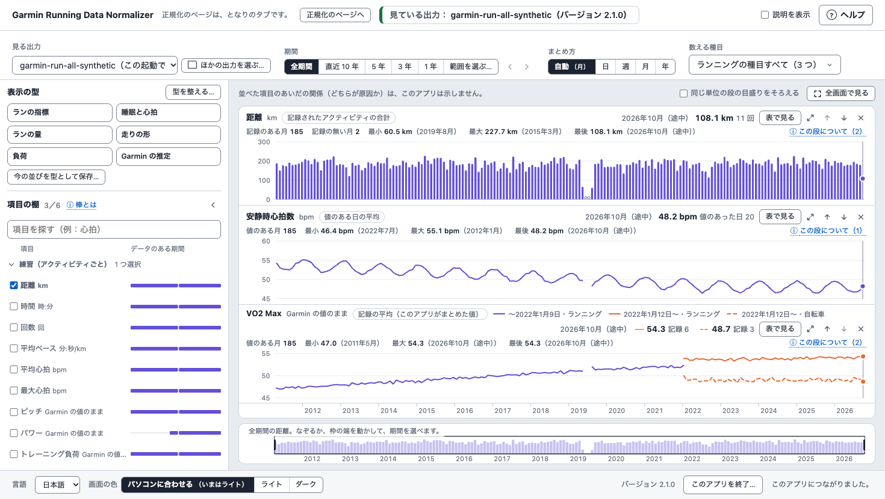

### 見るページを開く

- 正規化のあと、4 の箱の「次にすること」の「この出力を見る」を押すと、となりの
  タブにその出力が開きます。見るページがもう開いていれば、そのタブが前に出て、
  見る出力がこの出力に替わります。
- 正規化のページの下の帯の「見るページを開く」でも開けます。このときは、次の
  順に進みます。
  1. 見るページが開きます。出力はまだ開いていません。
  2. 段の出る所に、最近の出力を開くボタンが出ます。最近の出力は、この起動で
     正規化した出力か、無ければ、前の出力の一覧のいちばん新しいものです。
     前に並べた項目があれば「前に並べた項目で開く」、無ければ「最近の出力を開く」
     です（上の「見る出力」の欄の横にも出ます）。
  3. ボタンを押すと、その出力が開きます。まだ出力が無いときは、ボタンの代わりに
     「正規化のページへ」が出るので、先に正規化してください。
- 初めて開くと、距離・安静時心拍数・VO2 Max の 3 つの段を並べます（データの無い
  項目は外します）。見るページは出力を読むだけで、書き換えません。
- 見るページのいちばん上の「正規化のページへ」で、正規化のページのタブに
  戻ります。どちらのページも、もう開いていれば、新しいタブは作らずに、その
  タブが前に出ます。
- 見る出力は、上の「見る出力」の欄で選びます。この起動で正規化した出力と、前の
  出力の一覧が出ます。そこに無い出力は、「ほかの出力を選ぶ…」で選びます。
  フォルダーを選ぶ窓が開くので、正規化した出力のフォルダーそのもの（3 の箱の
  「新しく作るフォルダーの名前」で作ったフォルダー）を選んでください。それを
  入れたフォルダー（`GarminRunningData` など）を選ぶと、赤い枠に、開けないと
  出ます。
- このアプリの別のバージョンで作った出力は開けません（一覧に出ることがあります）。
  赤い枠に理由と次にすることが出ます。このバージョンで正規化し直してから
  開いてください。赤い枠の「正規化のページで正規化し直す」で、正規化のページに
  移れます。スナップショットに取り込んだ出力なら、1 の箱の
  「既存のスナップショットだけで正規化し直す」で正規化し直せます。取り込まずに
  正規化した出力なら、もとのエクスポートをもう一度正規化します。新しい
  バージョンに更新したあとも、前のバージョンで作った出力は、正規化し直すと
  見られます。

### 期間・まとめ方・数える種目

上の「期間」と「まとめ方」は、全部の段に効きます。「数える種目」は、練習と
走りの形の項目に効きます（体の記録（毎日）の項目と Garmin の推定値には効きません）。
期間とまとめ方は、はじめは「全期間」と「自動」です。2.2.0 からは、選んだものを
覚えていて、次に開いたときもそのままです（[次に開いたときに覚えるもの](#次に開いたときに覚えるもの)）。

- 期間：「全期間」「直近 10 年」「5 年」「3 年」「1 年」と「範囲を選ぶ…」です。
  直近 10・5・3・1 年は、出力の最後の日までを数えます（今日までではありません）。
  出力の最後の日は、アクティビティか毎日の記録がある最後の日で、アクティビティの
  最後の日とは限りません。今日より先の日付の記録は入らないので、今日より後には
  なりません（その数は、段の「この段について」に出ます）。
- 「範囲を選ぶ…」では、「始まり」と「終わり」の日を入れます。出力の日の範囲の
  外は切ります。期間の横の ‹（「同じ長さだけ前の期間へ」）と ›（「同じ長さだけ次の期間へ」）は、
  どの期間でも、同じ長さのまま前後に動かします（動かした期間は「範囲を選ぶ…」に
  なります）。出力の最初の日や最後の日まで来ると、押せなくなります。
- まとめ方：「自動」「日」「週」「月」「年」です。グラフの棒や点 1 つが表す期間を、
  この手引きでは「区切り」と呼びます（週は月曜日から）。「自動」は、期間が
  3 年より長いと月、1 年より長いと週、1 年以下は日にまとめ、いまのまとめ方は
  「自動（月）」のように出ます。直近 3 年はちょうど 3 年、直近 1 年はちょうど
  1 年なので、次のようになります。

| 期間 | 「自動」の区切り |
|---|---|
| 「直近 10 年」「5 年」 | 月 |
| 「3 年」 | 週 |
| 「1 年」 | 日 |
| 「全期間」と「範囲を選ぶ…」 | その長さで決まります（上の決まり） |

直近 3 年を月ごとに見るときは、「月」を押します。期間の始まりと終わりで日数が
足りない区切りには「（途中）」が付き、棒は薄く出ます（例：出力の最後の日がある月）。

- 数える種目：はじめは、出力にあるランニングの種目すべて（ランニング・
  トレイルラン・トレッドミル・トラックなど）です。「数える種目」の欄を押すと、
  出力にある種目の一覧が開き、チェックを入れて足したり、外したりできます。
  数える種目を変えると、練習と走りの形の段と、項目の棚の横棒が変わります。

### 表示の型（2.2.0 から）

「表示の型」は、段に並べる項目とその順番の組み合わせです（6 つまで）。項目の棚の
上に、型の札が 2 列で並びます。札を押すと、その型の項目が、型の順番で段に並びます。
期間・まとめ方・数える種目は、型に入りません（別に覚えます。
[次に開いたときに覚えるもの](#次に開いたときに覚えるもの)）。

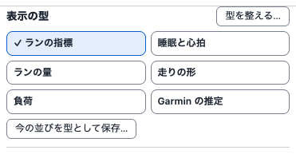

- 初めの型は 6 つです。
  - 「ランの指標」：「距離」「平均ペース」「平均心拍」
  - 「睡眠と心拍」：「睡眠時間」「睡眠スコア」「HRV（参考の値）」「安静時心拍数」
  - 「ランの量」：「距離」「時間」「回数」「総上昇量」
  - 「走りの形」：「ピッチ」「歩幅」「上下動」「接地時間（GCT）」
  - 「負荷」：「トレーニング負荷」「短期的負荷」「長期的負荷」「負荷比」
  - 「Garmin の推定」：「VO2 Max」「予想タイム ハーフ」「予想タイム フル」「持久力スコア」
- いま使っている型の札は塗られ、名前の前に ✓ が付きます。そのあとで段を足したり、
  外したり、順番を変えたりすると、札の名前の下に「（変えた）」が出ます。
- その出力に値の無い項目も、段として出ます（段の 2 行目に「この期間には値が
  ありません。」）。型の項目に、出力のどこにも値の無い項目があるときは、札に
  「値のある項目 2/4」のように出ます（出力の全体で数えます。選んだ期間では数えません）。
- 「今の並びを型として保存…」：いま並べている段に名前を付けて、自分の型にします。
  名前は 1〜30 字で、改行や見えない文字は使えません。初めの型の名前は、日本語でも
  英語でも使えません。自分の型は 20 までです。保存できなかったときは、そのわけが
  その場に 1 行出ます。
- 「型を上書き」：自分の型を使っていて、段を変えたときだけ出ます。いまの段で、その型を
  書き換えます。初めの型は上書きできないので、新しい型として保存してください。
- 「型を整える…」：小さな枠が開きます。
  - 自分の型：「名前を変える」「上へ」「下へ」「型を上書き」「消す」。
    ここの「型を上書き」は、使っている型でなくても、いまの段でその型を書き換えます。
    左のつまみ（⋮⋮）をなぞっても並べ替えられ、つまみを選んで ↑ ↓ キーでも動かせます。なぞっている途中に
    Esc を押すと、元の並びに戻ります。「消す」は、先に消してよいかを聞きます。そのとき
    選ばれているのは「消さない」です。
  - 初めの型：「隠す」と「出す」。隠した型は、札に出なくなります。「初めの型をすべて出す」で
    全部を戻せます。
  - 枠は「閉じる」か Esc で閉じます。枠の外を押しても閉じません（「数える種目」の枠と
    同じです）。

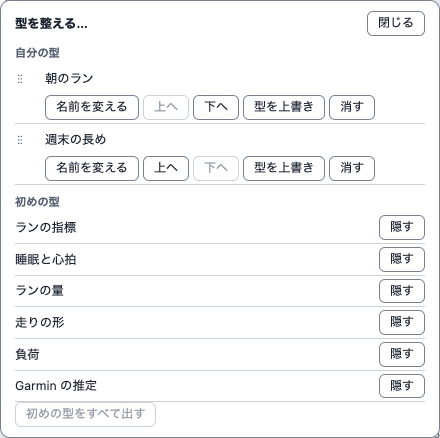

- 項目の棚を畳んだときは、左の細い列の「型」で札の枠が開き、1 回で選べます。
- 型の名前は、このコンピューターの設定に入ります（[プライバシー](#プライバシー)）。
  2 つのタブで型を変えても、変更は 1 つずつ残ります。ほかのタブで消された型を
  変えようとすると、そのことが出て、型の一覧を読み直します。

### 項目の棚と段

- 左の項目の棚には、38 の項目が 4 つのまとまり（練習（アクティビティごと）・
  走りの形（FIT）・体の記録（毎日）・Garmin の推定値）で並びます。走りの形は、
  上下動や接地時間など、時計が記録したアクティビティのファイル（FIT）の値です。
  項目の名前の右の横棒は、その項目のデータのある年月です（グラフの棒とは別の
  ものです）。「項目を探す」で、名前から探せます。
- チェックを入れた項目が、右に上から段として並びます。並べられるのは 6 つまでで、
  6 つ並べると、ほかの項目にはチェックを入れられません。足すときは、先にどれかを
  外してください。棚の見出しの横の「3／6」は、並べている項目の数と、並べられる
  数（6）です。
- 棚は ‹（読み上げの名前は「項目の棚を畳む」）で畳めます。畳んだ棚は、左に残る
  細い列の「項目の棚を開く」で開き直せます。
  畳んだままでも、段の上の「項目を足す」で選べます。
- 段の 2 行目には、その段のまとめが出ます：記録のある区切りの数
  （例「記録のある月 37」）と、最小・最大・最後の値とその区切りです。いちばん
  大きい月などは、ここで分かります。直近 3 年を月ごとに見ると、記録のある月が
  36 ではなく 37 になることがあります。期間の始まりと終わりの月が、どちらも
  「（途中）」の区切りとして入るためです。
- 段の右上には、1 つの区切りとその値が出ます：グラフにマウスを当てたときや、
  グラフを押して ← → キーを押したときは、縦の線のある区切り、そうでなければ最後の
  区切りです。縦の線を動かすと、全部の段の右上が、同じ区切りの値になります。
- 段ごとのボタンは、段の見出しの右にあります（見出しが 2 行に折れた段では、
  見出しの 2 行目の左にあります）。記号のボタンの名前（例「距離を大きく見る」）は、
  読み上げソフトが読む名前で、画面には記号だけが出ます。
  - 「表で見る」：その段の数字を、新しい順の表で見ます。表の見出しを押しても、
    並べ替わりません（いちばん大きい値は、段の 2 行目のまとめで見られます）。
    「グラフで見る」で戻ります。
  - ⤢（例「距離を大きく見る」）：その段を大きくし、ほかの段は細い段になります。
    時間の軸はそろったままです。大きくした段では、⤢ の所が「段を並べて見る」
    （2.1.0 では「元に戻す」）になり、押すと並べた形に戻ります。
  - ↑（例「距離を上へ」）・↓（例「距離を下へ」）：段の順番を変えます。
  - ×（例「距離を外す」）：段を外します。項目の棚のチェックを外しても同じです。
  - 「この段について」：その段に入っていない記録の数などを示します（例：値の無い
    アクティビティ、今日より先の日付の記録）。
- 同じ単位の段が 2 つ以上あるときは、段の上の右（「全画面で見る」の左）の
  「同じ単位の段の目盛りをそろえる」にチェックを入れると、目盛りがそろいます。
  はじめはチェックが入っていません。チェックを外すと、元に戻ります。

数字の決まり（段の名前の横の札が、その段の値の作り方です）：

- 距離・時間・回数・トレーニング負荷・総上昇量は、記録されたアクティビティの
  合計です。時間は、Garmin がアクティビティの時間として記録した値（エクスポートの
  duration）で、一時停止を含む全体の時間でも、動いていた時間だけでもありません。
  回数は、アクティビティの数です。
- 合計だけは、数える種目の最初と最後のアクティビティのあいだで、記録の無い区切りが
  0 になり、薄い点で出ます。最初より前と最後より後は空で、点は出ません。0 は
  「記録が無い」ことで、「走らなかった」とは限りません。0 の点は底の線の上の
  白抜きの点で、「（途中）」の区切りの薄い棒とは別のものです。
- 平均ペースは、時間の合計を距離の合計で割った値です。平均心拍・ピッチ・パワーと
  走りの形の項目は、時間で重みをつけた平均です（どちらも、このアプリが計算した
  値）。最大心拍は、その区切りのいちばん高い値です。これらは、記録の無い区切りでは
  空です。
- 体の記録（毎日）の項目は、値のある日の平均です。値の無い日を 0 や前の日の値で
  埋めることはしません。
- VO2 Max のように 1 日に 2 つ以上の記録がある項目は、日ごとでは点を全部出し、
  週・月・年では記録の平均を出します。
- 予想タイムは Garmin の予測で、走った記録ではありません。

### 全体図

- 段の下の全体図は、全期間を月ごとに出し、いま見ている期間を枠で示します。項目は、
  1 つ目の段か、大きくした段のものです。
- 全体図の上をドラッグする（マウスのボタンを押したまま横に動かす）と、その期間を
  見られます。ドラッグしているあいだは枠がついてきて、全体図の左上にその期間の
  日付が出ます。離すと、期間は「範囲を選ぶ…」になります。1 週間より短い
  ドラッグでは変わりません。
- 枠の端の近く（マウスの矢印が ↔ に変わる所）をドラッグすると、その端だけを
  動かせます。反対の端はそのままです。
- 枠の中でも、端から離れた所を押してドラッグすると、枠は動かず、押した日からの
  新しい期間になります。同じ長さのまま前後に動かすときは、期間の横の ‹ › を
  使います。
- ドラッグの途中で Esc を押すと、取りやめます。期間はそのままです。
- 元の期間に戻るときは、上の期間のボタン（例「3 年」）を押します。

### 区切りのアクティビティの一覧（2.2.0 から）

- 「練習（アクティビティごと）」と「走りの形（FIT）」の段では、グラフの区切り（週や月など、
  まとめ方の 1 つ）を押すと、その区切りのアクティビティの一覧が、段のすぐ下に開きます。
  グラフを押して ← → キーで区切りを選び、Enter キー（か Space キー）を押しても開きます。
  一度に開くのは 1 つです。体の記録や推定の段、「表で見る」の段、値が 1 つも無い段では
  開きません。
- 押して開いたときは、グラフが選ばれたままなので、← → キーで十字線を動かせます
  （一覧の区切りは変わりません）。Enter キーで開いたときは、一覧の見出しへ移ります。
  一覧の区切りには、グラフに青い枠が出ます。
- 列は「日時」「種目」と、距離・時間・平均ペース・平均心拍・最大心拍・ピッチ・
  総上昇量です。日時は、出力に書かれたその土地の日時を、「10/2（金）6:30」のような
  形で出します（タイムゾーンは直しません）。パワー・トレーニング負荷や走りの形の段
  から開いたときは、その項目の列が 1 つ足されます。値の無い所は「—」です。
- 列の見出しを押すと、その列で並べ替えます。押すたびに上りと下りが入れ替わり、
  値の無い行はどちらでも最後です。日時は、見えている日付と時刻の順です。
- 一覧の下に、「段の値：108.1 km（この値に数えた 11 件）」のように、その区切りの段の
  値と、その値に数えたアクティビティの数が出ます。段の右上の読み取りと同じ数です。
  心拍の無い記録のように、一覧に出ても数えないものもあります。
- 一覧に出るのは「数える種目」の種目だけです。1 つの区切りで 500 件までで、それより
  多いときは件数と、細かいまとめ方（年なら「月」、月なら「週」、週なら「日」）を
  案内します。
- 「閉じる」か Esc キーで閉じ、グラフに戻ります。期間・まとめ方・数える種目・出力・
  並べた項目・印・「表で見る」・大きく見る・全画面で見る・年でくらべるを変えたときも
  閉じます。言葉の切り替えと「同じ単位の段の目盛りをそろえる」では閉じません。
  一覧は覚えず、ファイルにも書きません。
- 一覧と段が別の読みから作られることについては、
  [見ている間に出力が変わったとき](#見ている間に出力が変わったとき220-から)を見てください。

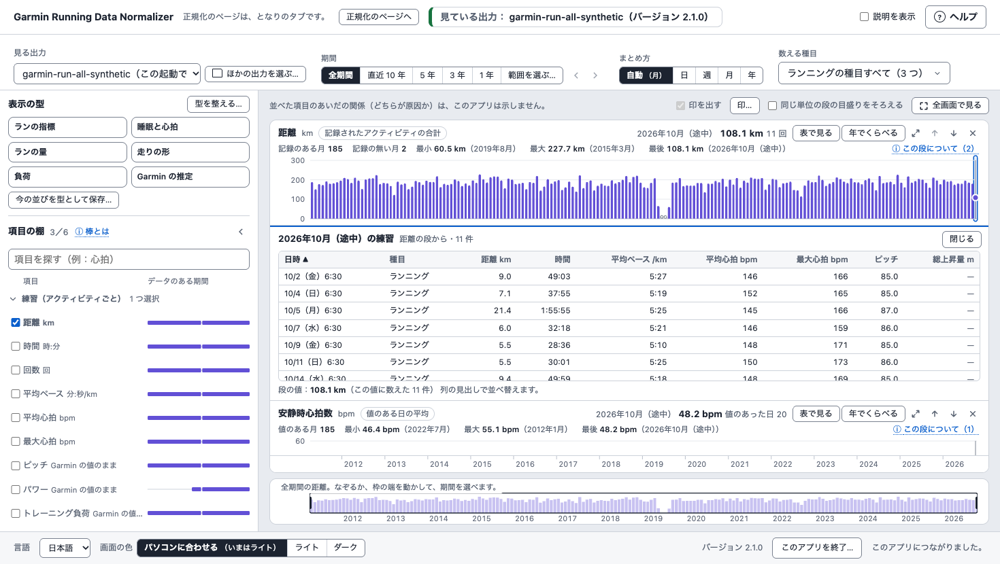

### 印（2.2.0 から）

- 印は、大会・けが・靴を替えた日など、自分の出来事に付ける目印です。段の上の
  「印…」で窓を開き、種類（「大会」「けが」「靴」「ほか」）、名前（1〜30 字）、日付を入れて
  「足す」を押します。期間の印は「終わりの日」も入れます。窓の一覧では、印ごとに
  「変える」と「消す」が使えます（消す前に聞きます。初めのボタンは「消さない」）。
  200 まで足せます。
- 印は、全部の段に細い縦の線で出ます。種類は線の形で分かれます：大会は
  実線（文字の色）、靴は点線、ほかは破線、けがは一点鎖線です。期間の印は薄い帯で、
  最初と最後の日のふちが、その種類の線です。全体図には、種類にかかわらず、印ごとに
  上の端の短い線だけが出ます（期間の印は最初の日に）。名前は、いちばん上のグラフに
  出ます（重なるときは「印 3」のように数だけ）。「印を出す」を外すと隠れます
  （覚えています）。
- 印は数字を変えません。読み上げでは、いちばん上のグラフが、期間の中の印の数と、
  名前と日付を 10 件まで言います。ほかのグラフは数だけです。
- 種類が「大会」の印は、年でくらべるの[大会の日でくらべる](#大会の日でくらべる)に
  使えます。
- 印は、このパソコンの GUI の設定のフォルダーの `gui-marks.json` にだけ残ります
  （[次に開いたときに覚えるもの](#次に開いたときに覚えるもの)）。自分の言葉なので、
  出力・問い合わせ用ファイル・GitHub への報告の文には入りません。
- 印のファイルを読めなかったときや、新しいバージョンのこのアプリが書いたファイルの
  ときは、印を出さず、ファイルも書き換えません（「足す」「変える」「消す」は灰色に
  なり、下の帯にわけが出ます）。

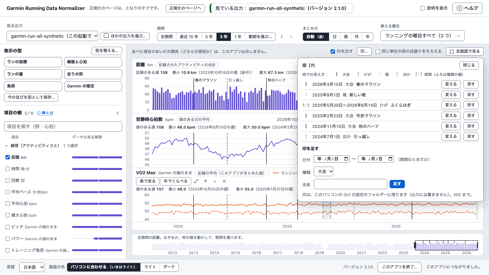

### 全画面で見る

- 段の上の「全画面で見る」で、グラフと全体図だけを出します。ブラウザーの全画面に
  できれば画面いっぱいに、できなければ窓いっぱいに出ます。上の 1 行に、見ている
  出力・期間・数える種目が出ます。
- 全画面でも、全体図をドラッグして期間を変えられます（上の期間のボタンは
  出ません）。
- 「元に戻す（Esc）」か Esc で、元の並びに戻ります。ブラウザーの全画面のときは、
  Esc でブラウザーの全画面が終わり、ページも元の並びに戻ります（右上の「ヘルプ」で
  開いた欄は、開いたままです）。
- 全体図のドラッグの途中の Esc は、ドラッグを取りやめるだけで、全画面のままです。
  ブラウザーの全画面のときは、最初の Esc でブラウザーの全画面が終わり、ドラッグも
  取りやめになります。
- 全画面は覚えません。次に開いたときは、ふつうの並びです。

### 年でくらべる（2.2.0 から）

- どの段の見出しにも「年でくらべる」があります。押すと、その段の項目を
  年ごとにくらべます。戻るときは「段を並べて見る」を押します。段・期間・
  まとめ方は、くらべる前のままです。日の無い出力では押せません。
- 段の上の帯で選びます。
  - 「項目」：題の中の一覧で、ほかの項目に替えられます。
  - 「見せ方」：「年ごとに並べる」（1 年を 1 段にして縦に並べます。目盛りは
    全部の段で同じです）、「重ねる」（年ごとの線を 1 つの段に重ね、線の端に
    年を出します）、「累積」（下を見てください）。初めは「年ごとに並べる」です。
  - 「月」：「1 年すべて」か、1 月〜12 月のどれか。月を選ぶと、毎年その月が
    並びます。
  - 「くらべる線」：VO2 Max のように線がいくつもある項目だけに出ます。段の
    凡例と同じ名前で 1 本を選びます。初めは、いちばん新しいデータ源の線です
    （ランニングがあればランニング）。
  - 「表で見る」：区切りが行、年が列の表になります。最後の行は、1 年
    （月を選んだときは 1 か月）の値です。* は途中で切れた区切り（出力の端や、
    年・月の端、大会の日で切れたもの）、— はその年に無い区切り（出力の外や、
    2 月 29 日のようにその年に無い日）です。
  - 「年」：出力にある年の札です。初めは新しい 4 年で、「6 年まで選べます」。

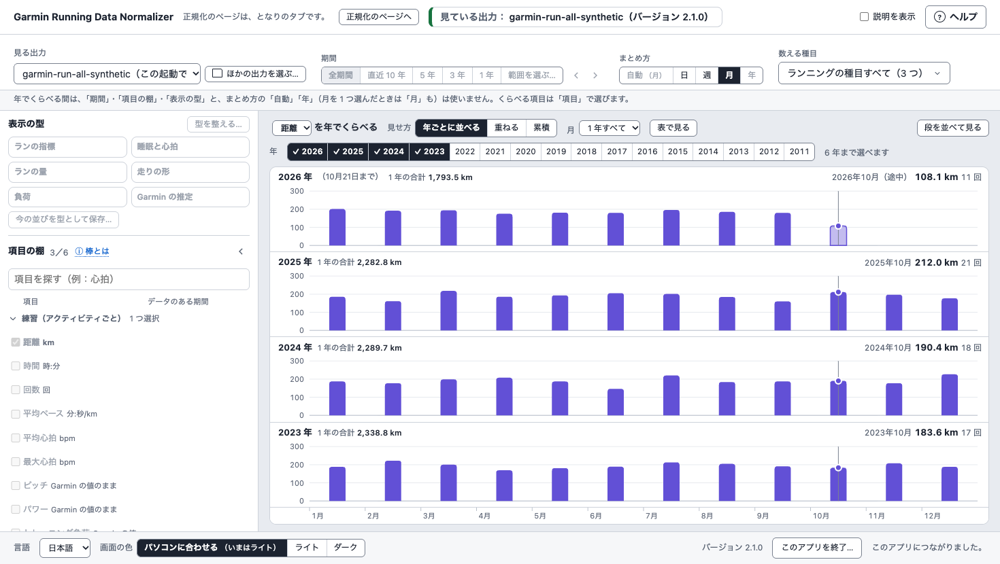

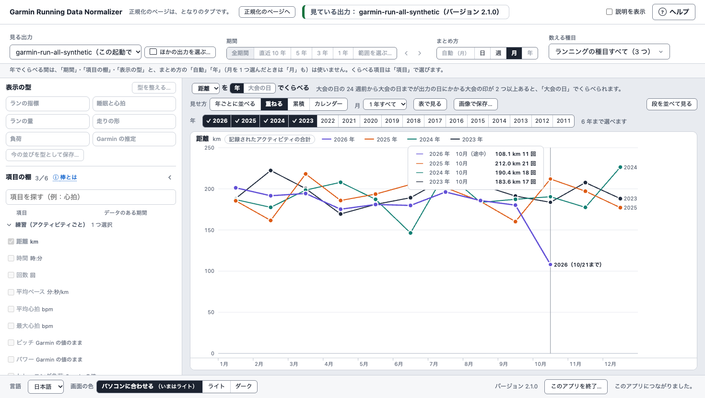

- まとめ方は、上の「まとめ方」の「日」「週」「月」から選びます（月を選んだときは
  「日」か「週」）。初めは「月」、累積は「日」、月を選んだときは「日」です。
- 区切りのそろえ方：
  - 週は、月曜からの週を、1 月 1 日（月を選んだときは、その月の 1 日）の週から
    数えた順番でそろえます。54 週まである年もあります。年（月を選んだときは月）の
    始まりと終わりの週は、その中の日だけの（途中）なので、ふだんの段の同じ週とは
    値が違うことがあります。
  - 日は、月と日でそろえます。2 月 29 日は、うるう年にだけ値があります。
  - 月を選んだときの日は、選んだ年のその月の日数までです。
- 段の見出しの「1 年の合計」などは、ふだんの段と同じ数え方の値です。出力が
  その年（月を選んだときはその月）の途中で始まるか終わるときは、途中の値で、
  見出しに「（10月21日まで）」のように出ます。
- 「累積」は、距離・時間・回数・トレーニング負荷・総上昇量の 5 つだけです。
  記録の無い区切り（0）はそのまま足し、値の無い区切りでは線が切れます。合計は
  それまでから続くので、年の終わりの累積は、その年の「1 年の合計」と同じです。
  表には件数の列がありません。ほかの項目では「累積」を押せず、「累積とは」で
  わけが開きます。
- くらべる間は、期間・‹ ›・範囲の欄・項目の棚・表示の型と、まとめ方の「自動」
  「年」（月を選んだときは「月」も）は使わず、灰色になります。フィルターの
  下に、そのことが 1 行で出ます。全体図は出ません。「数える種目」は使えます。
  変えると、戻ったあとの段にも効き、次に開いたときにも覚えています。
- 値の読み取り：「年ごとに並べる」では各段の右上に、「重ねる」と「累積」では
  十字線の横の枠に、その年の区切り（週はその年の日付）と値が出ます。グラフを
  押して ← → キーで 1 つずつ、Page Up と Page Down で 12 ずつ、Home と End で
  端へ動かすと、年ごとの区切りと値を読み上げます。
- 止まったとき：帯の下に、段と同じ言葉の止まりが出ます。数字が多すぎるときは、
  まとめ方を「週」か「月」に（月を選んだときは「週」に）してください。
- 年ごと・大会ごとの値が、並んだ段と別の読みから作られることについては、
  [見ている間に出力が変わったとき](#見ている間に出力が変わったとき220-から)を見てください。

#### 大会の日でくらべる

- 帯の題の「年」と「大会の日」で、何でくらべるかを選びます。「大会の日」は、大会の印
  （種類が「大会」の[印](#印220-から)）のうち、大会の日の 24 週前から大会の日までの
  どこかが出力の日にかかるものが 2 つ以上あるときに押せます。足りないときは灰色で、
  横にわけが出ます。
- 年の札の代わりに、大会の札が新しい順に出ます。初めは新しい 4 つで、6 つまで
  選べます。出力の最後の日より後の大会も選べ、それまでの週が出ます。
- 月の代わりの「範囲」で、8・12・16（初め）・20・24 週前から大会の日までを選びます。
  大会の週の月曜からさかのぼるので、どの大会も週の数がそろいます。まとめ方は「週」
  だけです（累積でも）。見せ方は年と同じ 3 つで、初めは「大会ごとに並べる」です。
- 「大会の週（大会の日まで）」は、大会の週の月曜から大会の日までです。大会が日曜で
  ないとき（や、出力がその週の途中で終わるとき）は、年の端の週と同じく途中の区切り
  です（棒は薄い塗りに縁取り、表は *、読み取りは（途中）の印）。段の見出しは
  「この範囲の合計」のように、範囲全体を 1 回で数えた値です。表の最後の行は
  「16 週前から大会の日までの合計」のように、範囲そのものです。
- 大会の札は、目には名前の頭と日付（例：春のマラソン 2026/3/15）、読み上げには
  名前の全部と日付（期間の印は始まりと終わりの日）を出します。
- 印を消したり変えたりして（ほかのタブで設定を消したときも）大会が 2 つ未満になると、
  年でくらべるに戻ります。消えた大会の値は出ません。
- 次に開いたときも、くらべ方（年か大会の日か）と範囲の週の数を覚えています。選んだ
  大会は覚えません。

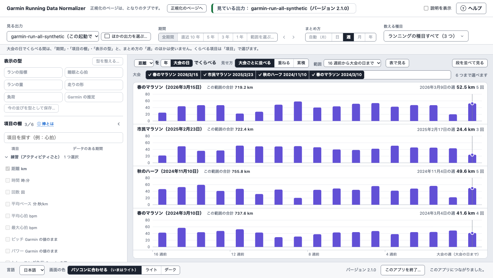

### 見ている間に出力が変わったとき（2.2.0 から）

- 見るページは、数字を問い合わせるたびに、出力が前と同じかを確かめ、変わっていれば
  読み直します（同じ出力を正規化し直したとき）。日付が変わったときも読み直します
  （今日より後の記録を外すため）。
- そのため、正規化し直した直後や日付が変わった直後は、年でくらべる（大会の日で
  くらべるも）の年ごと・大会ごとの値と、区切りのアクティビティの一覧が、並んでいる段と
  別の読みから作られることがあります。くらべ直す・一覧を開き直すと、新しい読みになり
  ます。

### 次に開いたときに覚えるもの

見るページを、この起動でもう一度開いたときや、次の起動で開いたときのことです。

- 覚えるもの：並べた項目とその順番（6 つまで。どの出力を開いても同じです）、
  項目の棚を開いているかどうか、画面の色（「ライト」か「ダーク」を選んだとき）。
  2.2.0 からは、期間、まとめ方、数える種目、表示の型（保存した型と、最後に使った型）、
  [年でくらべる](#年でくらべる220-から)の見せ方と月、くらべ方（年か大会の日か）と
  範囲の週の数、「印を出す」かどうかも覚えます。[印](#印220-から)そのものは、印の
  ファイルに残ります。
  ほかの出力を開いて、その出力に並べた項目の値が無いときは、その段の 2 行目に
  「この期間には値がありません。」と出ます。
- ほかの出力を開いたとき（2.2.0 から）：「1 年」などの期間は、そのままです。
  「範囲を選ぶ…」で選んだ期間は、その出力の日の範囲と一部だけ重なるときは
  重なる所に縮まり、まったく重ならないときは「全期間」になります。数える種目は、
  覚えた種目のうち、その出力にある種目です。1 つも無いときは、その出力の
  ランニングの種目すべてです。
- 覚えないもの：見ていた出力、目盛りをそろえるか、段を大きくしたか、表で見ていたか、
  全画面、年でくらべるを開いていたかと、選んだ年や大会、区切りの一覧を開いていたか。見ていた出力は覚えないので、下の帯から開いたときは、
  [見るページを開く](#見るページを開く)のボタンで最近の出力を開きます。
- 正規化のページの下の帯の「覚えた設定を消す…」は、これらも、保管場所・出力を
  作る場所・前の出力の一覧も、全部忘れます。次の起動は初めてと同じ進み方に
  なります（[2 回目からの起動](#2-回目からの起動)）。

### 画面の色

正規化のページと見るページの下の帯の「画面の色」で、「パソコンに合わせる」
「ライト」「ダーク」を選べます。2 つのページで同じ色になり、最後に選んだものを、
次に起動したときも使います。「パソコンに合わせる」は、パソコンのライトとダークの
設定を、ブラウザーが伝えるとおりに使います。横の「（いまは…）」に、いまの色が
出ます。ブラウザーによっては、ブラウザー自身の色の設定が先になり、パソコンの
設定と違うことがあります。

### 同じ数字を CSV に書く（コマンドライン）

見るページと同じ数字を、`series` のコマンドで CSV のファイルに書けます。新しい
ターミナルの窓（macOS ではターミナル、Windows では PowerShell）を開いて動かします
（GUI を動かしている窓ではありません）。たとえば、直近 3 年の距離と安静時心拍数を
月ごとに書くときは、次のとおりです。

macOS：

```bash
~/garmin-normalizer/bin/python -m garmin_running_data_normalizer series --run-output "/path/to/output" --output "/path/to/new-file.csv" --item dist --item rhr --period 3y --grain month
```

Windows PowerShell：

```powershell
& "$HOME\garmin-normalizer\Scripts\python.exe" -m garmin_running_data_normalizer series --run-output "C:\path\to\output" --output "C:\path\to\new-file.csv" --item dist --item rhr --period 3y --grain month
```

- `--run-output` には、正規化した出力のフォルダーを入れます。4 の箱の
  「出力のフォルダーを表示」で、その場所を見られます。`--output` には、新しく作る
  CSV のファイルを入れます。どちらも、例の `/path/to/…` を自分の場所に置き換えて
  ください。同じ名前のファイルがもうあるときと、出力のフォルダーの中に書こうと
  したときは、書かずに止まります。
- `--period 3y` は「3 年」、`--grain month` は「月」と同じです。`--period` を付けないと
  「全期間」、`--grain` を付けないと「自動」です。項目の名前（`dist`・`rhr` など）と、使える値の全部は、次の 1 行で
  見られます（Windows では、上の例と同じ書き方で `series --help` を動かします）。

```bash
~/garmin-normalizer/bin/python -m garmin_running_data_normalizer series --help
```

- 数字に入らなかったもの（値の無い記録など）は、CSV ではなく、ターミナルに
  `about` で始まる行で、数だけ出ます。CSV をほかのアプリや AI に渡すときは、
  その行も一緒に渡してください。
- CSV には、出力と同じく、あなたの個人のデータが入っています。macOS と Linux では、
  このコンピューターのほかのアカウントからは読めない形で書きます（Windows では、
  フォルダーの決まりに従います）。ほかの人に渡すときは、出力を渡すときと同じように
  気をつけてください。

### 見るページから終える

見るページのいちばん下の「このアプリを終了…」でも、正規化のページの「終了」と
同じように、このアプリを終えられます。問い「このアプリを終了しますか？」は、
下の帯の左の端に出ます（「このアプリを終了…」は右の端にあります）。「終了する」を
押すと終わり、もう 1 つのページにも、終わったことが出ます。「やめる」か Esc で、
そのまま使えます。正規化が動いているあいだに押すと、終了できないことが出ます。
終えたあとは、タブを閉じてかまいません。また使うときは、アイコンかコマンドで
起動します。

## 2 回目からの起動

2 回目の起動からは、GUI が覚えた設定を使います。

- 1 の箱でエクスポートを確かめると、2 の箱と 3 の箱が、前から順に自動で
  決まります。
  - 2 の箱は、覚えていた保管場所が問題なく開くときに決まります。
  - 3 の箱は、覚えていた出力を作る場所があるとき、または既定の場所のときに
    決まります。
  - 自動で決まった箱は、1 行の説明の終わりに「（前回のまま）」が付きます。
  - ほかの保管場所を開くなど、箱の内容を変えたときは、正規化の前に、その箱で
    もう一度「この内容で決める」を押してください。
  - 覚えた保管場所が無いときは、2 の箱は初めての起動と同じく、決めるのを待ちます
    （見えないところで保管場所を作らないためです）。
- 画面の右上の「説明を表示」は、初めての起動ではオン、2 回目からはオフです。
  切り替えると、その選び方を覚えます。
- 正規化する前は、「データの種類ごとの結果」に前回の出力の件数が出ます。
  正規化のあとは、「前回の出力から」の列に種類ごとの増減を、4 の箱に
  アクティビティの増減を出します。増減を出すのは、前回の出力と今回が、同じ
  正規化のしかた（スナップショットか、今回のエクスポートだけか）・同じ
  バージョン・同じタイムゾーンのときだけです。違うときは、何が違うかを 1 行で
  出します。
- 出力には、どの保管場所で正規化したかが残りません。保管場所を変えたあとの増減は、
  2 つの保管場所の出力を、そのまま比べた数です。

出力の呼び方は 3 つあります。

- 前の出力の一覧：GUI が覚えている、正規化で作った出力です（新しい順に 10 個まで）。
  この起動でいちばん最後に正規化した出力は、別に出すので、一覧には入りません。
  見るページの「見る出力」などで選べます。
- 前回の出力：前の出力の一覧のうち、いちばん新しく、読める出力です。正規化の
  ページは、これと増減を比べます。
- 最近の出力：見るページで開く出力の案です。この起動で正規化した出力か、無ければ、
  前の出力の一覧のいちばん新しい出力です。

GUI が覚えるのは、次のものだけです。

- 場所：スナップショットの保管場所、出力を作る場所、前の出力の一覧（正規化で
  作った出力、新しい順に 10 個まで）。覚えるのはフォルダーの場所だけで、フォルダーの
  中身は覚えません。場所は、正規化で出力を作ったときに覚えるので、間違えて開いた
  場所は残りません。
- 「説明を表示」のオンとオフ、画面の色（「ライト」か「ダーク」を選んだとき）、
  見るページで並べた項目と、項目の棚の開け閉め。2.2.0 からは、見るページの期間・
  まとめ方・数える種目と、表示の型（保存した型と、最後に使った型）、年でくらべるの
  しかた（見せ方・月・くらべ方・範囲の週の数）、「印を出す」かどうかも。
- 前に出力を作った正規化のタイムゾーン（2.2.0 から）。2 回目からは、3 の箱がこのタイムゾーンで
  決まります（「（前回のまま）」）。
- 見るページの印（2.2.0 から）。印だけのファイルに残します。

エクスポートの場所、3 の箱の「新しく作るフォルダーの名前」、言語、正規化のしかたは
覚えません。

設定のファイルは、このアプリの設定のフォルダー `garmin-running-data-normalizer` の中の
`gui-settings.json` です。2.2.0 からは、見るページの印を、
同じフォルダーの `gui-marks.json` に残します。

- Mac：ホームのフォルダーの中の `Library/Application Support` にあります。Finder の
  「移動」のメニューを開いて option キーを押すと出る「ライブラリ」から開けます。
- Windows：`LOCALAPPDATA` にあります。エクスプローラーのアドレス欄に
  `%LOCALAPPDATA%` と入れて開けます。
- Linux：`XDG_STATE_HOME`（無ければホームのフォルダーの中の `.local/state`）に
  あります。

覚えていた場所が見つからないとき（動かした、外付けのディスクを外した、など）は、
その箱が赤になります。2 の箱には「ほかの保管場所を開く…」「もう一度探す」
「新しい保管場所を作る…」が、3 の箱には「選ぶ…」と「もう一度探す」が出ます。
どちらの場所も作り直しません。出力を作る場所が既定の `GarminRunningData` の
ときだけは、無ければ、正規化するときに作ります。

下の帯の「覚えた設定を消す…」は、先に聞いてから、設定のファイルを消します。
2.2.0 からは、同じフォルダーの見るページの印のファイル `gui-marks.json` も消します
（印は戻せません）。画面の色と、見るページで並べた項目と棚の開け閉め、自分の
表示の型、期間とまとめ方と数える種目、年でくらべるのしかた（見せ方・月・くらべ方・
範囲の週の数）、「印を出す」かどうか、前に出力を作った正規化のタイムゾーンも忘れます。
実行中は消しません。覚えた設定が無いあいだは押せません。保管場所と出力は残り、次の起動は初めてと同じ進み方に
なります（既定の場所にない保管場所は、開き直しになります）。設定のファイルを
読めなかったときは、下の帯にそう出て、初めての起動として始めます。

## 困ったとき

「困ったとき」は、4 の箱のいちばん下の部分です。押すまでは 1 行にたたんであり、
ヘルプの「よくある質問」を開くボタン、出力の確認、問い合わせ用ファイル、
GitHub での報告があります。止まって赤くなった箱のことは、
[うまくいかないとき](#うまくいかないとき) を見てください。

「対象の出力」で、確認と問い合わせ用ファイルの対象を選びます。「今回の出力」か、
「前に作った出力」の一覧（GUI が覚えていて、今もある出力。新しい順）から選ぶか、
一覧の最後の「ほかの出力を選ぶ…」でほかのフォルダーを選びます。
「出力を確認する」は、「出力の確認」と同じ確認をします。1.4 より前の
バージョンで作った出力には、このバージョンの診断がありません。その出力の
`START_HERE.md` の結果を使ってください。別のバージョンで作った出力は、
このバージョンでは確かめられません。このバージョンでもう一度正規化してください。

「問い合わせ用ファイルを作る」を押すと、
`<出力の名前>-support-bundle.zip` を作ります。`support-bundle` のコマンドと
同じです。「問い合わせ用ファイルを置く場所」の既定は出力のフォルダーの隣で、
「選ぶ…」でほかのフォルダーを選べます。選ぶフォルダーは、すでにあって、
出力のフォルダーの外にあることが必要です。押す前に、作るファイルと置き場所が
出ます。

- 中身は、要約のファイル 6 個です。記録の行、場所（パス）、ファイル名、
  識別子、正確な時刻、位置の座標は入りません。どこにも送りません。
- 渡す前に、6 個のファイルをすべて確かめてください。中の件数から、
  どれくらい使っているかが分かることがあります。
- 同じ名前のファイルがあるときは、上書きしません。移すか名前を変えるか、
  別の置き場所を選んでください。
- 「保存した場所を表示」は、macOS では Finder で、Windows ではエクスプローラーで、
  作ったファイルを選んだ形で表示します。Linux では、`xdg-open` が選ぶファイルの
  アプリで、そのファイルのあるフォルダーを開きます。

問い合わせ用ファイルの中身は
[v1.4 Export Evidence and Diagnostics](v1_4_diagnostics.md#support-bundle) を、
問い合わせ先は [Support](../SUPPORT.md) を見てください。

### GitHub で報告する

次にすることで直らないときは、止まりの説明を終える行（直すためのボタンのあと）の
「GitHub で報告する」か、「困ったとき」の最後の「GitHub で報告する…」を押します。
どちらも、ヘルプの欄の「困ったとき」を開き、リポジトリの報告の書式（Bug report）に
入る値を先に見せます：コードを入れた題、画面のどこか、OS とそのバージョン、
Python のバージョン、`--version` が出す 1 行、この起動の正規化のしかた、
終了コード、コード。パス・名前・件数・日付・時刻・タイムゾーンは入れません。
「GitHub で開く」を押すと、ブラウザの新しいタブで書式が開きます。このとき
値が GitHub に届き、報告を出すまでは公開されません。GitHub にログインして
いないときは、先にログインの画面が出ます。「何が起きたか」にターミナルの行を
貼るときは、[GUI を開けないときに知らせる](#gui-を開けないときに知らせる)のとおりに、
名前の出る所を書き換えます。何が起きたかは自分で書き、合成データで
起きるかを選び、個人のデータを入れていないことの 4 つのチェックを入れて
ください。ファイルは添付しないでください。安全の問題（脆弱性）は、公開の報告には
書かず、[Security](../SECURITY.md) のとおり非公開の窓口から知らせてください。
GUI を開けないときは、[GUI を開けないときに知らせる](#gui-を開けないときに知らせる)の
とおりにします。

ヘルプの欄からは、手引きと、このバージョンの tag のリポジトリの文書、
Garmin のアカウントのデータを管理するページへのリンクも開けます。リンクは、
押したときだけ新しいタブで開きます。開発中は、バージョンの名前が前に公開した
バージョンのままなので、リンクはそのバージョンの文書を開きます。

## ヘルプと説明の表示

右上の「ヘルプ」は、窓の右にヘルプの欄を開きます。欄は画面を覆わず、画面を
横に寄せて開きます。5 つの部分があります。

- 「使い方」：Garmin からエクスポートを手に入れる方法と、4 つの箱の決め方です。
  手順を押すと、その箱が光ります。最後の「結果を読む」は、4 の箱の
  「次にすること」にある「START_HERE.md を開く」でファイルを開くと、「済み」に
  なります。ほかのしかたで開いたときは、「済み」になりません。この手引きと
  Getting Started from Garmin Export へのリンクもあります。
- 「よくある質問」：ダウンロードした ZIP のまま使えるか、このアプリが何を
  覚えているか、日付が Garmin Connect と 1 日ずれるのはなぜか、などの答えです。
- 「言葉」：正規化、スナップショット、保管場所など、画面の言葉の意味です。
- 「AI で使う」：出力を AI で使う手順と、「コピー」で写せる質問の例です。
  手元か信頼できる AI 向けの例と、外の AI 向けに AI などに渡せる要約を使う
  例があります。
- 「困ったとき」：GitHub での報告のしかたです。
  [GitHub で報告する](#github-で報告する)と同じです。

「閉じる」か Esc キーで閉じます。

上の「説明を表示」は、それぞれの箱の見出しの下に、ヒントを 1 行ずつ出します。
初めての起動ではオン、2 回目からはオフです。切り替えると、その選び方を覚えます。

説明のボタン（「説明」「中身を見る」「意味」）は、説明するものの横にあり、
押すとその下に説明が開きます。正規化のしかた、スナップショットの保管場所、
出力を作る場所、タイムゾーン、AI などに渡せる要約、終了コード、「困ったとき」に
あります。説明は、もう一度ボタンを押すか Esc キーを押すまで開いたままです。
ボタンの上にマウスを置いただけでは開きません。読み上げソフトでは、説明が開いた
ときにその文が 1 回読まれ、フォーカスはボタンに残ります。

箱の下の「色の意味」は、画面の 5 つの色の意味です。青はいま操作するところか
実行中、緑は済み・決めた、黄は警告（使えるが、確かめてほしい）、赤は問題
（直す必要がある）、灰は無い・まだ（問題ではない）です。色だけで知らせることは
なく、言葉でも出します。

## うまくいかないとき

画面が先に進めないときは、問題のある箱が赤になり、「起きたこと」「次にすること」
「コード」を出します。上の「次にすること：」の行も、その箱を指します。止まった
正規化は、出力のフォルダーを作りません。問い合わせるときは、コードを添えて
ください。エクスポートや出力は添付しないでください。表は、1 の箱から 4 の箱、
そして「困ったとき」の順です。

| コード | 起きたこと | 次にすること |
|---|---|---|
| `PATH_NOT_ABSOLUTE` | 場所が、フルパスではありません。 | 「選ぶ」のボタンで選ぶか、Mac や Linux では / から、Windows では C:\\ のようなドライブから始まる場所を貼り付けてください。 |
| `FOLDER_NOT_READABLE` | このアプリは、このフォルダーを開けません。 | Mac では、確かめの画面で許可するか、システム設定の「プライバシーとセキュリティ」で許可してください。 |
| `CHOOSER_BUSY` | ほかの選ぶ窓が開いています。 | その窓で選ぶか閉じてから、もう一度押してください。 |
| `INPUT_ZIP_CORRUPT` | ZIP が壊れているか、途中までしかありません。 | Garmin のページから ZIP をダウンロードし直して、選び直してください。また壊れているときは、Garmin に新しいエクスポートを頼んでください。 |
| `INPUT_MULTIPLE_EXPORTS` | 違うエクスポートが混ざっています。選んだフォルダーに、2 つ以上のエクスポートか、違うアカウントのエクスポートがあります。どれを正規化するか決められません。 | 正規化するエクスポートを 1 つだけ選んでください。 |
| `ACTIVITIES_NOT_FOUND` | エクスポートに、アクティビティのファイルがありません。 | アクティビティが入っているエクスポートを選んでください。 |
| `INPUT_CHANGED` | 読んでいるあいだに、エクスポートが変わりました。 | ほかのアプリがエクスポートを変えていないときに、もう一度「正規化を実行」を押してください。 |
| `SNAPSHOT_LABEL_EXISTS` | 保管場所に、同じ名前のスナップショットがあります。 | スナップショットの名前を変えてください。 |
| `SNAPSHOT_STORE_NOT_FOUND` | 選んだフォルダーは、スナップショットの保管場所ではありません。 | 保管場所のフォルダーを選び直すか、新しい保管場所を作る場所を選んでください。 |
| `SNAPSHOT_STORE_LOCKED` | 保管場所に、目印のファイル（.single-writer.lock）があります。取り込みが動いているか、前の取り込みが途中で止まりました。 | ほかに正規化やスナップショットのコマンド（ターミナルや別のタブ）が動いていなければ、下の ✓ を入れて「目印のファイルを消す」を押してください。消すのはこのファイルだけで、スナップショットは消えません。 |
| `SNAPSHOT_STORE_PATH_TOO_LONG` | 保管場所の中のファイルのパスが、このコンピューターには長すぎます。 | もっと上の階層の場所にある保管場所を選んでください（Windows では、長いパスを使える設定にもできます）。 |
| `OUTPUT_EXISTS` | 同じ名前のフォルダーがすでにあります。 | 別の名前にしてください。 |
| `OUTPUT_NAME_INVALID` | このフォルダーの名前は使えません。 | 200 バイト（日本語ならおよそ 66 文字）までで、「.」で始めず、「.」や空白で終わらず、< > : " / \\ \| ? * を使わず、Windows の装置の名前（CON・NUL など）でない名前にしてください。 |
| `OUTPUT_PARENT_NOT_WRITABLE` | 出力を作る場所に、このアプリが書き込めません。 | 別の場所を選ぶか、このアプリに書き込みを許してください。 |
| `OUTPUT_PATH_TOO_LONG` | 出力の場所と名前を合わせると、このコンピューターには長すぎます。 | もっと上の階層の場所を選ぶか、名前を短くしてください（Windows では、長いパスを使える設定にもできます）。 |
| `TIMEZONE_INVALID` | このタイムゾーンの名前は使えません。 | Asia/Tokyo や America/New_York のような、正確な名前を入れてください。 |
| `RUN_ACTIVE` | ほかのタブか窓で、正規化が動いています。 | 終わるまで待つか、取り消してください。 |
| `OUTPUT_PUBLISH_FAILED` | 出力のフォルダーを書き出せませんでした。変換までは終わりましたが、書き出す途中で止まりました。 | ディスクの空きと、出力を作る場所に書き込めるかを確かめて、もう一度「正規化を実行」を押してください。エクスポートを選び直す必要はありません。 |
| `COMMAND_FAILED` | このアプリの処理が、思いがけず止まりました。 | もう一度押してください。また止まるときは、コードを知らせてください。 |
| `HANDOFF_INVALID` | フォルダーが正規化の出力でないか、出力のファイルが確かめに通りません。 | 正規化の出力のフォルダーを選んでください。出力のフォルダーなら、中のファイルは変えずに、新しいフォルダーにもう一度正規化してください。 |
| `OUTPUT_OTHER_VERSION` | この出力は、このアプリの別のバージョンで作りました。このバージョンでは確かめられません。 | このバージョンで、新しいフォルダーにもう一度正規化してください。 |
| `SUPPORT_BUNDLE_EXISTS` | 置き場所に、同じ名前のファイルかリンクがすでにあります。 | 今あるファイルを移すか名前を変えるか、別の置き場所を選んでから、もう一度押してください。 |

ほかのコードのときは、画面の「次にすること」に従ってください。それで直らない
ときは、[GitHub で報告する](#github-で報告する) を見てください。

エクスポートが混ざっているときは、混ざっているところの箱に出ます。選んだ入力の
中なら 1 の箱、保管場所のスナップショットと違うアカウントのエクスポートか、
違うアカウントのエクスポートが入った保管場所なら 2 の箱で、それぞれの次に
することが出ます。

GUI は、1 つのタブで使ってください。選ぶ窓は、どのタブからでも、同時に 1 つしか
開けません。ほかのタブか、読み込み直す前のこのページが窓を開いているときは、
`CHOOSER_BUSY` と出ます。その窓を閉じてから、もう一度押してください。2 つの
タブで同時に選ぶと、片方は何も選ばなかったことになることがあります。そのときは、
そのボタンをもう一度押してください。ほかのタブで始めた正規化は、どのタブにも
出て、終わるまでほかの正規化は始められません（`RUN_ACTIVE`）。

画面に「このアプリが応答しません」と出たときは、ターミナルの窓を閉じた、
どのページも 60 分間開いていなかった、などの理由で、GUI が止まっている
可能性があります。
アイコンから起動したときはアイコンをもう一度ダブルクリックし、ターミナルから
起動したときは同じコマンドで起動し直して、新しいアドレスを開いてください。
アドレスと鍵は、起動のたびに変わります。

## GUI を終える

GUI を使っている間、ターミナルの窓（アイコンから起動したときは、アイコンが
開いた窓）は、アドレスなどを表示したまま止まって見えます。それで正常です。

- 画面の下の「終了」を押すと、下の帯に「このアプリを終了しますか？」と出ます。
  「終了する」を押すと終わり、「やめる」か Esc で、そのまま使えます。終わるあいだは、
  帯に「このアプリを終了しています…」と出て、終わると、ページに、終わったことと、
  もう一度起動するしかたが出ます。タブは閉じてかまいません。作った出力は、
  そのまま残ります。終えたあとは、ページのボタンでは開けないので、Finder や
  エクスプローラーで開いてください。
- 見るページのいちばん下の「このアプリを終了…」でも、このアプリを終えられます
  （[見るページから終える](#見るページから終える)）。
- ターミナルで `Ctrl+C`（macOS でも control キーと C）を押しても、GUI は終わります。
  アイコンから起動したときは、アイコンが開いた窓がターミナルです。
- どちらで終えても、GUI が止まると、ターミナルに「GUI stopped.」と出ます。そのあとは、
  ターミナルの窓を閉じてかまいません（Windows でアイコンから起動したときは、
  窓が自分で閉じます）。
- 実行中は「終了」を押せません。先に実行を取り消してください。`Ctrl+C` は、
  実行を取り消してから GUI を止めます。
- 実行を止めているあいだの 2 回目の `Ctrl+C` は、何もしません。実行が
  終わってから、GUI が止まります。`Ctrl+C` で実行を取り消したときは、
  ターミナルに、コマンドラインで取り消したときと同じ、`ERROR [RUN_CANCELLED` で
  始まる行が出ます。
- スクリプトから `gui` のコマンドを動かす人へ：終了コードは、「終了」のあとと、
  実行していないときの `Ctrl+C` のあとは 0、`Ctrl+C` で実行を取り消したときは
  130 です。130 は取り消した実行のコードで、このアプリのエラーではありません。
- どのページも開いていないまま 60 分たつと、実行中でなければ、GUI は
  自分で止まります。ブラウザのタブを閉じても、すぐには止まりません。

## このアプリを片付ける

このアプリを使わなくなったら、次の順に片付けます（新しいバージョンに更新する
ときは、片付けません）。

1. 保管場所や出力を作る場所を変えていたときは、2 と 3 の箱に出ている場所を
   書き留めます（覚えた設定を消すと、画面に出なくなるためです）。
2. GUI の覚えた設定も消すときは、GUI を終える前に、正規化のページの下の帯の
   「覚えた設定を消す…」で消します。保管場所と出力は残ります。
3. GUI を終えます（[GUI を終える](#gui-を終える)）。
4. 次のものを、ごみ箱へ入れます。
   - ホームのフォルダーの `garmin-normalizer`：
     [Python とこのアプリを入れる](#python-とこのアプリを入れる)の 1 行で作った仮想環境です。
     このアプリは、この中に入っています。5 の `GarminRunningData`（あなたの個人の
     データ）とは別のフォルダーです。ほかのしかたで入れたときは、このフォルダーは
     ありません。代わりに `pip uninstall garmin-running-data-normalizer` で、この
     アプリを外します。
   - アイコン（作ったとき）：macOS ではデスクトップの「Garmin Running Data Normalizer」です。
     Windows では、デスクトップのショートカットと、スタートメニューのショートカット
     「Garmin Running Data Normalizer」です。スタートメニューの分は、エクスプローラーの
     アドレス欄に `shell:programs` と入れて開くフォルダーの中にあります。Linux では、
     アイコンは作りません。
   - 設定のフォルダー `garmin-running-data-normalizer`（残っているとき）：場所は、
     [2 回目からの起動](#2-回目からの起動)にあります。2 をしたときは、ふつうは
     このフォルダーも消えています。2 をしなかったときは、設定のファイルがこの中に
     あります。
5. 次のものは、もう使わないときだけ、ごみ箱へ入れます。どれも、あなたの個人の
   データが入っています。まだ使うときは残してください。
   - スナップショットの保管場所（エクスポートの写しが入っています）と出力：既定では、
     ホームのフォルダーの中の `GarminRunningData` です。1 で書き留めた場所も
     見てください。
   - ダウンロードしたエクスポートの ZIP（展開したときは、そのフォルダーも）。
   - `series` で書いた CSV のファイル（作ったとき）。

Windows で `garmin-normalizer` をごみ箱へ入れるときに、使用中で移せないと出たら、
少し待ってから「再試行」を押してください。

このアプリのために Python そのものを消す要はありません。ほかのアプリが使って
いることもあります。Python も消すときは、python.org の文書のとおりにして
ください（[macOS](https://docs.python.org/3/using/mac.html)、[Windows](https://docs.python.org/3/using/windows.html)）。

## プライバシー

- 正規化の出力とスナップショットの保管場所には、あなたの個人のデータが
  入っています。あなたが渡さない限り、このコンピューターの外には出ません。
- GUI は、自分からはネットワークに何も送りません。利用の記録を集める
  仕組みもありません。画面は、GUI の外から何も読み込みません。ヘルプの欄の
  リンクは、押したときだけ新しいタブでページを開き、「GitHub で開く」が
  GitHub に渡すのは、画面が先に見せた値だけです。
- AI などに渡せる要約と問い合わせ用ファイルは、渡すために作るものですが、
  渡す前に中身を確かめてください。スナップショットの名前は、どちらにも
  入りません。
- 見るページは出力を読むだけで、数字を外へ送りません。`series` の CSV には、
  出力の値が入ります。
- 覚えた設定には、場所の名前と、見るページの項目の名前が入ります。2.2.0 からは、
  保存した表示の型の名前、「範囲を選ぶ…」で選んだ期間の日付、数える種目、
  タイムゾーンも入ります。このコンピューターの外には出ず、問い合わせ用ファイルにも
  入りません。ほかの人も使うコンピューターでは、「覚えた設定を消す…」で消してください。
- 見るページの[印](#印220-から)（2.2.0 から）は、名前と日付があなたの言葉と出来事
  なので、印のファイル `gui-marks.json` にだけ残します。出力・問い合わせ用ファイル・
  GitHub への報告の文には入りません。「覚えた設定を消す…」で、設定と一緒に消えます。
- [区切りのアクティビティの一覧](#区切りのアクティビティの一覧220-から)（2.2.0 から）は、
  出力の日時などを画面に出すだけで、ファイルには書きません。

[Security and Privacy Boundary](security_and_privacy_boundary.md) も
見てください。

## GUI の守り

- GUI は `127.0.0.1` だけで待ち受けるので、ほかのコンピューターからは
  つながりません。
- どの要求にも、この起動のアドレスにある鍵が要ります。同じコンピューターの
  ほかのプログラムやほかのアカウントは、鍵が無いと GUI を使えません。
- cookie は使いません。要求や場所（パス）を記録しません。

## キーボードとスクリーンリーダー

- すべての操作を、キーボードで行えます。フォーカスの位置は、いつも
  見えるようにしています。
- スクリーンリーダーは、実行の段階、止まっていること、取り消し、終わりを
  読み上げます。毎秒変わる件数は読み上げません。
- 箱を決めると、フォーカスは次の箱に移ります。正規化が終わると結果の見出しに、
  止まるとその箱の止まりの見出しに移ります。ただし、画面のほかの場所に
  移っていたときは、そのままにします。
- ヘルプの欄は画面の横に並ぶもので、ダイアログではありません。欄やその部分を
  開くと、フォーカスはその見出しに移り、欄の中で Esc キーを押すと閉じます。
- 見るページでは、グラフを押して ← → キーで縦の線を動かせます。値は、それぞれの
  段の右上に出ます。「表で見る」では、段の数字を表で見られます。
- 年でくらべる（2.2.0 から）では、← → キーなどで動かすと、年ごとの区切りと値を
  読み上げます（[年でくらべる](#年でくらべる220-から)）。大会の日でくらべるときの大会の
  札は、名前の全部と日付を読み上げます。
- 練習と走りの形の段のグラフ（2.2.0 から）は、Enter キーで区切りの一覧が開くことを
  読み上げます。Enter キー（か Space キー）で開くと、フォーカスは一覧の見出しに移り、
  届いた件数を読み上げます。列の見出しのボタンで並べ替えられ、見出しは並べた向きを
  伝えます。
  Esc キーで閉じると、グラフに戻ります
  （[区切りのアクティビティの一覧](#区切りのアクティビティの一覧220-から)）。
- 印（2.2.0 から）は、いちばん上のグラフが、期間の中の印の数と、名前と日付を
  10 件まで読み上げます（[印](#印220-から)）。

## GUI とコマンドライン

GUI は、コマンドラインと同じ処理を行います。今回のエクスポートだけで正規化する
ときは、次のコマンドと同じです。

```bash
garmin-running-data-normalizer run-all --input /path/to/export --output /path/to/new-output --timezone Asia/Tokyo
```

エクスポートをスナップショットに取り込み、まとめて正規化するときは、次の
コマンドと同じです。

```bash
garmin-running-data-normalizer snapshot register --store /path/to/store --input /path/to/export --label 2030-01-01 --requested-at 2030-01-01T02:00:00+00:00 --downloaded-at 2030-01-01T02:00:00+00:00 --observed-at 2030-01-01T02:00:00+00:00 --confirm-complete
garmin-running-data-normalizer snapshot run-all --store /path/to/store --output /path/to/new-output --timezone Asia/Tokyo
```

既存のスナップショットだけで正規化し直すときは、2 つ目のコマンドだけを
使います。AI などに渡せる要約も作るときは、どちらも `--external-safe-pack` を
付けます。

画面は、ダウンロードした日時を、エクスポートの 3 つの日時 `--requested-at`・
`--downloaded-at`・`--observed-at` のどれにも使います。コマンドラインでは 3 つを
別々に入れられるので、1 つの保管場所に、コマンドで取り込んだ回（Garmin に
リクエストした日時が入る）と、画面で取り込んだ回（ダウンロードした日時が入る）が
混ざることがあります。スナップショットの順番は `--observed-at` の日時の順で、
画面で取り込んだ回ではダウンロードした日時です。また画面は、エクスポートを読む
前にスナップショットの名前を確かめ、保管場所にある名前なら止めます。
コマンドラインは先にエクスポートを読み、保管場所にもうあるエクスポートなら、
どの名前でも新しい回を増やしません。

画面で作った保管場所は、`snapshot init` をしなくても、そのままコマンドラインで
使えます。画面は、次のコマンドと同じように保管場所を読み、目印のファイルを
`snapshot unlock` と同じように消します。

```bash
garmin-running-data-normalizer snapshot status --store /path/to/store
garmin-running-data-normalizer snapshot verify --store /path/to/store
garmin-running-data-normalizer snapshot unlock --store /path/to/store --confirm-no-other-command
```

エクスポートの確認、出力の確認、問い合わせ用ファイルは、次のコマンドと同じです。

```bash
garmin-running-data-normalizer doctor --input /path/to/export
garmin-running-data-normalizer validate-handoff --input /path/to/output
garmin-running-data-normalizer doctor --run-output /path/to/output
garmin-running-data-normalizer support-bundle --run-output /path/to/output --output /path/to/support-bundle.zip
```

見るページの数字は、次のコマンドが CSV に書く数字と同じです
（[同じ数字を CSV に書く（コマンドライン）](#同じ数字を-csv-に書くコマンドライン)）。

```bash
garmin-running-data-normalizer series --run-output /path/to/output --output /path/to/new-file.csv
```

コマンドラインは、どの場所も引数で受け取り、既定の場所はありません。コマンドの
あいだで何も覚えず、前の出力からの増減も出しません。それぞれの出力の件数は、
その出力の `run_summary.json` にあります。自動で動かすときは、コマンドラインを
使ってください。
