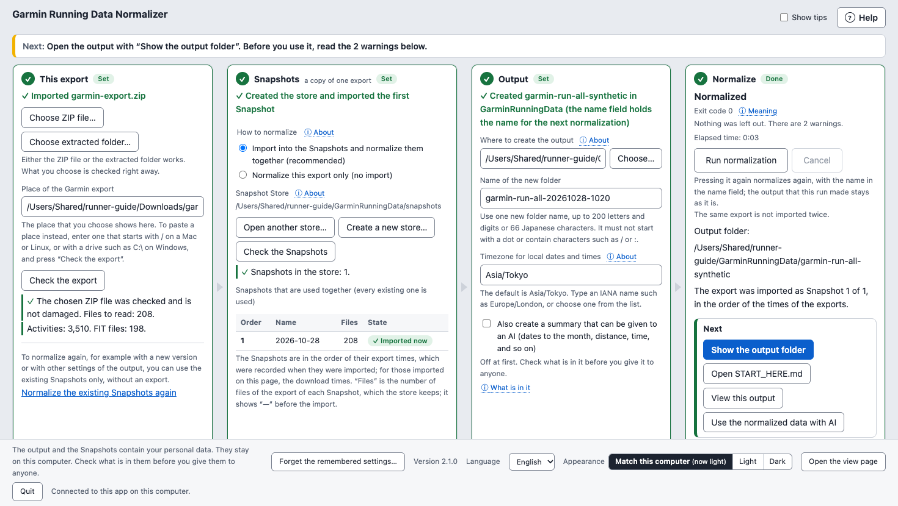
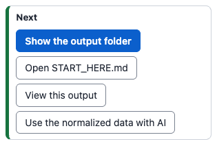
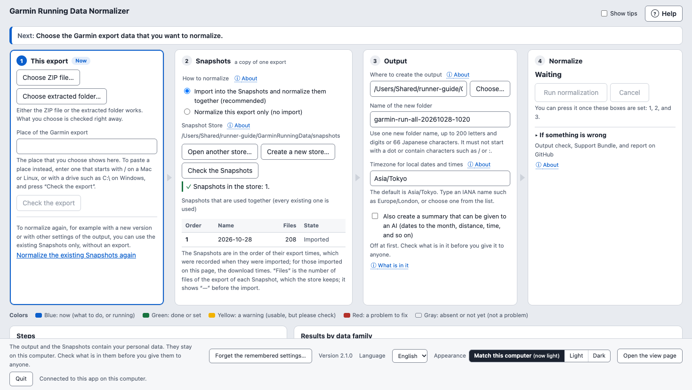
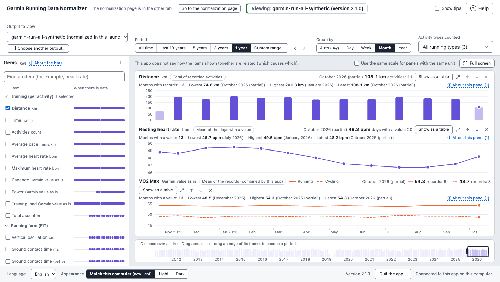
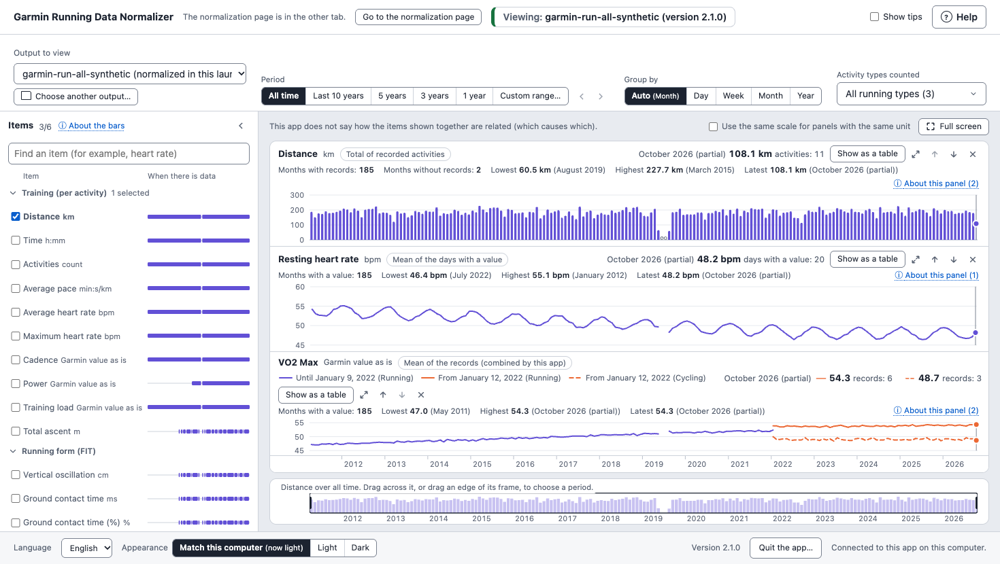

# GUI Guide

> **This guide is for v2.1.0.** v1.7.1 and earlier releases do not have the
> GUI. [What you need](#what-you-need) says how to install v2.1.0. If you keep
> using v1.7.1 or an earlier release, use the command line as described in
> [Getting Started from Garmin Export](getting_started_from_garmin_export.md).

[日本語](gui_guide.ja.md)

The GUI normalizes a Garmin Account Data Export from a page in your web
browser. By default it keeps each Export as a Snapshot and normalizes the
Snapshots together, so that the output also holds what earlier Exports held;
it can also normalize one Export alone. It uses the same processing as the
command line: for the same input and options, it writes the same output.
Everything stays on your computer.

## How it goes

A first normalization takes these four steps. The sections that the links
lead to give each step in full.

1. [Request the Export](#what-you-need): request it from Garmin, and download
   its ZIP file once Garmin has it ready.
2. [Install this app](#install-python-and-this-app): install Python if
   needed, and paste one line into a terminal. The line installs this app,
   makes an icon that starts the GUI, and opens the GUI.
3. [Normalize in the four boxes](#normalize-for-the-first-time): choose the
   ZIP file in box 1, set boxes 2 and 3, and press **Run normalization** in
   box 4.
4. [Look on the view page](#the-view-page-from-210): **View this output** in
   box 4 opens it in another tab.



Adding a new Export later, and the other cases, are in
[Ways to use it](#ways-to-use-it).

## What you need

- A Garmin Account Data Export: the ZIP file downloaded from Garmin, or the
  folder extracted from it. **How to use** in the help panel of the GUI says how to get
  one; see also steps 1 and 2 of
  [Getting Started from Garmin Export](getting_started_from_garmin_export.md).
  Garmin may take some time after your request before you can download the
  Export, so request it early. You may also install this app first and read
  **How to use** before you request it.
- Python 3.11 or later, and this app, v2.1.0, which the steps below
  install. Nothing else needs to be installed for the GUI.
- A web browser on the same computer, in a window of a desktop or laptop
  computer. The page is not made for phones or tablets.
- Free space for the Snapshot Store, which keeps a copy of the files of each
  Export (a file that an earlier Export had is kept once), and for a new
  output folder.

### Install Python and this app

In this guide, the terminal is the window of PowerShell on Windows, whose
lines start with PS, and the Terminal on macOS. Paste the commands of this
guide there: the Command Prompt of Windows does not take them.

1. See whether Python 3.11 or later is installed: run `python3 --version` in
   the Terminal on macOS, or `py --version` in PowerShell on Windows. When the
   number after "3." is 11 or more, as in "Python 3.11.9" or "Python 3.14.0",
   you can use it: go on to step 4. When it is 10 or less, as in
   "Python 3.9.6" or "Python 3.10.12", it is too old, and when the command is
   not found (on Windows, the line says that it is not recognized), Python is
   not installed: go on to step 2. When macOS opens a window that asks whether
   to install the developer tools as you check (the terminal shows a line
   that starts with `xcode-select`), Python is not installed either: do not
   install them in that window (do not choose **Install** there), and go on
   to step 2. The Python that those tools bring, such as 3.9, can be too old
   for this app. When you installed them already, see the version again
   with `python3 --version` once they are installed.
2. Install Python from the page of
   [python.org](https://www.python.org/downloads/):
   - macOS: use the **Download Python** button, and open the downloaded file.
     When the installation is complete, double-click
     **Install Certificates.command** in the window of the folder of Python to
     complete it, as [python.org describes](https://docs.python.org/3/using/mac.html): it installs the
     certificates that Python uses for secure connections. It opens a window
     of the Terminal, which shows lines in English and stops when it is done:
     you may close that window then. When the window of the folder is
     closed, the file is in the folder named like **Python 3.14** in
     **Applications** of the Finder.
   - Windows: use **Download Python install manager**, open the downloaded
     file, and choose **Install**. This app is not checked with Python
     installed from the Microsoft Store. Then:
     - When no Python is installed yet, as when step 1 said that `py` is not
       recognized: open a new PowerShell window, and run `py --version`.
       Starting Python with `py`, as `py --version` does, installs the latest
       Python by itself. On the way, you may be asked in English whether to
       add a folder to `PATH`, the list of folders where commands are looked
       for; the line below uses `py`, so either answer works.
     - When an older Python is installed already, `py` starts that one, as
       when step 1 showed 3.10 or earlier: then run
       `pymanager install default` in PowerShell, which installs the latest
       Python. Then open a new PowerShell window and run `py --version` again.
       When it still shows the older Python, it is usually because the Python
       Launcher that came with the older Python takes the `py` command: remove
       the Python Launcher in **Installed apps**, as
       [python.org describes](https://docs.python.org/3/using/windows.html),
       open a new PowerShell window, and check again. **Installed apps** is
       under **Apps** in the Settings of Windows (**Apps & features** on
       Windows 10). Keep the Python install manager and Python 3.11 and later.
       When it still shows the older Python, remove Python 3.10 and earlier
       too, and check again. Other apps may use the older Python: when you do
       not know whether you may remove it, keep it, and tell us
       ([Tell us when the GUI does not open](#tell-us-when-the-gui-does-not-open)).
3. Open the terminal again (on Windows, open a new PowerShell window), and
   see the version again with `python3 --version` (on Windows,
   `py --version`). When it is 3.11 or later, go on to step 4. When it is
   still old, or the command is not found, close every window of the
   terminal (on macOS, quit the Terminal with **Terminal** > **Quit Terminal**
   in its menu), open it again, and see the version again. When it is still
   old on Windows, go on with the item above for an older Python that is
   installed already, from what you have not done yet. When you have done it
   all, when the command is still not found, or when it is still old on
   macOS, tell us
   ([Tell us when the GUI does not open](#tell-us-when-the-gui-does-not-open)).
4. Run the line below. It makes the virtual environment `garmin-normalizer`
   in your home folder, installs v2.1.0 in it, makes the icon that starts the
   GUI ([Start the GUI from an icon](#start-the-gui-from-an-icon)), and opens
   the GUI. Each part runs only after the one before it has succeeded. When
   the line makes the icon, macOS may ask whether the Terminal may use the
   desktop; choose **Allow**. Keep the terminal window open while you use the
   GUI. The line is long: copy it with the copy button at the top right of its
   box, and paste it in the terminal.

   macOS:

   ```bash
   python3 -m venv ~/garmin-normalizer && ~/garmin-normalizer/bin/python -m pip install garmin-running-data-normalizer==2.1.0 && ~/garmin-normalizer/bin/python -m garmin_running_data_normalizer gui --create-shortcut
   ```

   Windows PowerShell, in any version (version 5.1 has no `&&`, so that the
   parts are joined with `if ($?)`, one inside the other):

   ```powershell
   py -m venv "$HOME\garmin-normalizer"; if ($?) { & "$HOME\garmin-normalizer\Scripts\python.exe" -m pip install garmin-running-data-normalizer==2.1.0; if ($?) { & "$HOME\garmin-normalizer\Scripts\python.exe" -m garmin_running_data_normalizer gui --create-shortcut } }
   ```

   - When the line succeeds, the terminal shows three lines at its end, and
     the GUI opens in your browser: "GUI address (it contains the launch key;
     do not share it):", the address, and "Stop with Ctrl+C or the Quit button
     on the page.". The terminal then seems to stand still, because the GUI is
     running; that is as it should be. On the way, pip may say that a new
     release of pip is available; you need not mind it. In the window of
     PowerShell, select the address and right-click to copy it: `Ctrl+C` in
     that window can stop the GUI, and cancel a normalization that runs.
   - When the line stops on the way, with a line of an error, no page, and the
     prompt for the next command, see
     [When the line stops on the way](#when-the-line-stops-on-the-way), set it
     right, and then run the same line again. When you ran the line before you
     installed Python, or with an old Python, or when it stops at the same
     place again, first move the folder `garmin-normalizer` that it made in
     your home folder to the Trash (the Recycle Bin on Windows), and then run
     it again. When there is no such folder, there is nothing to move. How to
     open your home folder follows these steps. After `ERROR [SHORTCUT_`, you
     need not move the folder.
   - To update to a new version, see
     [Update to a new version](#update-to-a-new-version).

On Linux, which has no icon, leave out `--create-shortcut`. When you no
longer use this app, see [Remove this app](#remove-this-app).

To open your home folder on macOS, choose **Go** > **Home** in the menu of
the Finder. On Windows, type `%USERPROFILE%` in the address bar of File
Explorer and press Enter. **Home** on the left of File Explorer in Windows
11 is not this folder.

### When the line stops on the way

A line that stopped shows a line of an error, opens no page, and gives the
prompt for the next command back: on macOS, a line that ends with %; on
Windows, a line that starts with PS. When the line succeeded and the GUI runs,
the terminal shows its last three lines and seems to stand still, but it has
not stopped. Here are the usual lines, and what to do: look for the words of
the left column in the lines that it showed.

| A line that says | The usual reason | What to do |
|---|---|---|
| `command not found` (macOS), or `is not recognized` (Windows) | Python is not installed, or the terminal was not opened again after you installed it. | Install Python from python.org, and open the terminal again. |
| `'&&'` and `is not a valid statement separator` (Windows) | The line for macOS was pasted in Windows PowerShell 5.1, which has no `&&`. PowerShell ran no part of it, and nothing changed. | Run the line for Windows PowerShell in [What you need](#what-you-need) instead. There is nothing to move to the Recycle Bin. |
| `xcode-select` (macOS) | Python is not installed, and macOS asks whether to install the developer tools. | Do not install them in that window (do not choose **Install** there); install Python from python.org, and open the Terminal again. |
| `Requires-Python` | Python is too old (3.10 or earlier). | Install Python 3.11 or later, open the terminal again, move the folder `garmin-normalizer` in your home folder to the Trash, and run the line again. On Windows, when an older Python is installed already, follow its steps in [What you need](#what-you-need) until `py --version` shows 3.11 or later. |
| `Retrying` and `connection` | The computer cannot reach the internet, or the network of your company stops it. | Check the connection; on a computer of your company, check its rules too. |
| `No matching distribution found`, without `Requires-Python` and `Retrying` | Python is too old (an old pip does not show the line of `Requires-Python`), or this version is not found. | Run `python3 --version` (on Windows, `py --version`). When it is 3.10 or earlier, do as for `Requires-Python` above. When it is 3.11 or later, copy the line of the guide, paste it, and run it again. |
| A line that starts with `ERROR [SHORTCUT_` | The icon could not be made; this app is installed. | Do what [When the icon could not be made](#when-the-icon-could-not-be-made) says for the code, or start the GUI without the icon with the command for macOS or Windows in [Start the GUI](#start-the-gui), which runs the Python of the virtual environment. |

After you set it right, run the same line again. When it stops at the same
place again, move the folder `garmin-normalizer` in your home folder to the
Trash (the Recycle Bin on Windows) first, and then run it again; after
`ERROR [SHORTCUT_`, you need not. When the line is not in the table, or it
still stops, tell us as
[Tell us when the GUI does not open](#tell-us-when-the-gui-does-not-open) says.

### Tell us when the GUI does not open

When the GUI does not open, or a step above asks you to tell us, tell us
with the Bug report form: choose **New issue** in
[Issues](https://github.com/tsubotti63/garmin-running-data-normalizer/issues)
of the page of this app on GitHub, and then **Bug report**. You need an
account of GitHub, which you can make for free.
[Report a problem on GitHub](#report-a-problem-on-github) also says how to
fill in the form. Without the GUI, fill in its fields in this way:

- **Problem**: what happened.
- **Guide or command**: the part of this guide, such as step 4 of
  [Install Python and this app](#install-python-and-this-app).
- **Operating system**: the system and its version, such as Windows 11; on
  macOS, **About This Mac** in the Apple menu shows it.
- **Shell**: the Terminal (zsh) on macOS, or PowerShell on Windows.
- **Python version**: the line that `python3 --version` (on Windows,
  `py --version`) shows.
- **Package version**: the line that `--version` shows
  ([Update to a new version](#update-to-a-new-version)); when the line
  stopped before this app was installed, the version that you were
  installing, 2.1.0.
- **Sanitized reproduction**: the line that you ran. The line of this
  guide holds no name, so you may paste it as it is.
- **Exit code**: write that you do not know it, when you do not.
- **Does the tracked synthetic fixture reproduce the problem?**: choose
  **Not tested**.
- **Public-safe logs**: the line of the error and a few lines before it.
  When no line of an error showed, as when you do not know whether you may
  remove an older Python, paste what `python3 --version` or `py --version`
  showed, and write what you did.
- **Privacy confirmation**: tick the four checks once you have written
  other words in place of names.

Paste lines as text, and do not attach a picture of the screen. Before you
paste them, write other words in place of names:

- Your user name shows in paths, right after `/Users` on macOS or
  `C:\Users` on Windows, and in the prompt, such as before `@` on macOS:
  write `USER` in its place.
- The name of your computer shows after `@` in the prompt of macOS: write
  `COMPUTER` in its place.
- The names of other folders, such as the folder of OneDrive of your
  company, may hold names too: write `FOLDER` in their place.

Do not paste the address of the GUI either: it holds the key of the launch.

### Update to a new version

The page shows the version of this app at its bottom, for example
Version 2.1.0, and this command shows it in a new window of the terminal,
not the one where the GUI runs:

macOS:

```bash
~/garmin-normalizer/bin/python -m garmin_running_data_normalizer --version
```

Windows PowerShell:

```powershell
& "$HOME\garmin-normalizer\Scripts\python.exe" -m garmin_running_data_normalizer --version
```

This app does not tell you when a new version comes out: look at the page of
this app on GitHub (https://github.com/tsubotti63/garmin-running-data-normalizer)
from time to time. Near the top of the README, which the page shows below the
list of files, **Current stable release** names the latest version, and the
[Releases](https://github.com/tsubotti63/garmin-running-data-normalizer/releases) page lists every release, with the
latest one marked **Latest**. When it is newer than the version that you
have:

1. On macOS as on Windows, stop the GUI first
   ([Stop the GUI](#stop-the-gui)). When the icon started it, close the window
   that the icon opened too. When more than one GUI is open, stop them all.
2. Open the guide of the new version, and run the line of the guide of that
   version in the same way. The link to the GUI Guide in the README on the
   page of this app on GitHub
   (https://github.com/tsubotti63/garmin-running-data-normalizer) opens that
   guide. The line installs into the same virtual environment
   `garmin-normalizer` and makes the icon again.
3. The Snapshot Store, the outputs, and the settings that the GUI remembers
   are outside the virtual environment, and stay as they are.

When you run the line while the GUI is open, the earlier GUI keeps running,
and one more GUI opens. On Windows, a line in English that starts with
"Unable to copy" also shows on the way: it says that the Python in use could
not be copied again, and the line goes on. The page of the earlier GUI stays
at the earlier version, but a run that you start there runs with the new
version, so that the versions are mixed. When this happens, stop every GUI
that is open, and then run the same line again.

## Ways to use it

The steps of six common cases. The sections that the links lead to give the
details of each box. A Snapshot is a copy of one Export, which this app keeps
in a Snapshot Store, so that the Exports that you import are normalized
together ([Box 2](#box-2-snapshots)).

### Normalize for the first time

When: you downloaded the Export ZIP file from Garmin, and use this app for the
first time.

1. [Start the GUI](#start-the-gui). Right after you install this app, the
   line that installed it has opened the GUI already.
2. In box 1, press **Choose ZIP file…**, and choose the ZIP file that you
   downloaded, without extracting it. When the browser extracted it already,
   choose that folder with **Choose extracted folder…**. Box 1 turns green
   once the check is done.
3. In box 2, press **Use these settings**. In box 3, check
   **Timezone for local dates and times** (`Asia/Tokyo` by default), and
   press **Use these settings**.
4. In box 4, press **Run normalization**. When it says **Normalized**,
   **View this output** under **Next** opens the view page, and
   **Open START_HERE.md** opens the file that explains the output.



More: [Box 1](#box-1-this-export), [Box 2](#box-2-snapshots), [Box 3](#box-3-output), [Box 4](#box-4-normalize)

### Add a new Export (later launches)

When: some months later, you downloaded a new Export.

1. [Start the GUI](#start-the-gui). Boxes 2 and 3 show the Snapshot Store and
   the folder for the output of the last time.
2. In box 1, choose the new ZIP file. Once it is checked, boxes 2 and 3 are
   set by themselves when the remembered places are found
   ([Later launches](#later-launches)). Set a box that waits with
   **Use these settings**.
3. The timezone is not remembered: when yours is not `Asia/Tokyo`, choose it
   again in box 3, and press **Use these settings** there.
4. In box 4, press **Run normalization**. A new folder holds an output that
   includes what earlier Exports held. The outputs before stay as they are.



More: [Later launches](#later-launches), [Box 2](#box-2-snapshots)

### Try a normalization without importing

When: you want to try this Export alone, without importing it into the
Snapshots.

1. [Start the GUI](#start-the-gui), and choose the Export in box 1.
2. Under **How to normalize** in box 2, choose
   **Normalize this export only (no import)**, and press
   **Use these settings**. The Snapshot Store is not used.
3. In box 3, press **Use these settings**, and in box 4,
   **Run normalization**.

The way to normalize is not remembered: at the next launch, box 2 is back to
importing.

More: [Box 2](#box-2-snapshots)

### Normalize again after an update

When: you update this app to a new version. The view page opens only the
outputs made by the version in use, even after a small update, so the earlier
outputs do not open there. They stay as they are.

1. [Update to the new version](#update-to-a-new-version), and then
   [start the GUI](#start-the-gui).
2. If you imported your Exports into the Snapshots, press
   **Normalize the existing Snapshots again** at the bottom of box 1, without
   choosing an Export. If you did not, choose the original Export in box 1,
   and choose **Normalize this export only (no import)** in box 2 again: the
   way to normalize is not remembered.
3. Set boxes 2 and 3 with **Use these settings** if they wait.
4. In box 4, press **Run normalization**. A new folder holds the output of
   the new version, which **View this output** opens.

More: [Box 1](#box-1-this-export), [Open the view page](#open-the-view-page)

### See the past year by month on the view page

When: you want to see the distance or the resting heart rate of the past year,
by month.

1. [Open the view page](#open-the-view-page).
2. Press **1 year** under **Period**, and **Month** under **Group by**, at the
   top. They apply to every panel.
3. To see the year before, press ‹ next to the period.



More: [Period, grouping, and activity types](#period-grouping-and-activity-types)

### Give the numbers to an AI as a CSV file

When: you want to give the numbers of the view page to a spreadsheet app or an
AI.

1. In a new window of the terminal, not the one where the GUI runs, run the
   line of `series` that
   [Write the same numbers to a CSV file (command line)](#write-the-same-numbers-to-a-csv-file-command-line)
   gives, with your own places.
2. The CSV file holds your personal data. Before you give it, check who gets
   it and what is in it.
3. Give the CSV file with the lines that start with `about`, which the
   terminal shows: they count what the numbers leave out, such as records
   without a value.

To use the output itself with an AI, start from
**Use the normalized data with AI** under **Next** in box 4.
[Box 3](#box-3-output) can also make a summary that can be given to an AI.

More: [Write the same numbers to a CSV file (command line)](#write-the-same-numbers-to-a-csv-file-command-line)

## Start the GUI

When the line in [What you need](#what-you-need) installed this app, it is in
that virtual environment: double-click the icon
([Start the GUI from an icon](#start-the-gui-from-an-icon)), or run this
command with the Python of the virtual environment, as the icon does.

macOS:

```bash
~/garmin-normalizer/bin/python -m garmin_running_data_normalizer gui
```

Windows PowerShell:

```powershell
& "$HOME\garmin-normalizer\Scripts\python.exe" -m garmin_running_data_normalizer gui
```

When you installed this app in another way and the command
`garmin-running-data-normalizer` works, for example in a virtual environment
that you activated, this command also starts the GUI; the line of this guide
alone does not make this command work:

```bash
garmin-running-data-normalizer gui
```

The command prints the GUI's address and opens it in your default browser.
With `--no-browser`, it only prints the address, for you to open.

- The address contains a key for this launch only. Do not share it. A page
  without the key cannot use the GUI; if the page says so, open the address
  shown in the terminal.
- Keep the terminal open while you use the GUI, and use the GUI in one tab of
  the browser.
- The page follows your browser's language. You can switch between English
  and Japanese under **Language** in the bar at the bottom of the page; the
  choice is kept for that browser tab.
- The bar at the bottom of the page, with **Language** and **Quit**, stays at
  the bottom of the window while you scroll the page.
- In the bar at the bottom, **Appearance** chooses the colors of the page
  ([Appearance](#appearance)), and **Open the view page** opens the view page
  ([The view page (from 2.1.0)](#the-view-page-from-210)).

The page has four boxes, numbered in the order in which you set them:
1 **This export**, 2 **Snapshots**, 3 **Output**, and 4 **Normalize**. The
line **Next:** at the top says what to do now, and the box to work on is
marked **Now**. **Use these settings** sets the second and the third box; in
the box to work on, it is filled blue, as the button to press next. A
box that is set is marked **Set** and says in one line what the run will do
with it. Under the boxes come **Colors**, the meaning of the colors of the
page, and two tables: **Steps**, the steps of a run with the time of each, and
**Results by data family**.

## Start the GUI from an icon

On macOS and Windows, `--create-shortcut` makes an icon that starts the GUI,
and then opens the GUI as the command does without it. The line in
[What you need](#what-you-need) makes the icon in this way too. To make the
icon again, for example after you replaced Python or the virtual
environment, or moved the icon to the Trash, run this command with the Python
of the virtual environment when the line installed this app.

macOS:

```bash
~/garmin-normalizer/bin/python -m garmin_running_data_normalizer gui --create-shortcut
```

Windows PowerShell:

```powershell
& "$HOME\garmin-normalizer\Scripts\python.exe" -m garmin_running_data_normalizer gui --create-shortcut
```

When the command `garmin-running-data-normalizer` works, this command also
makes it:

```bash
garmin-running-data-normalizer gui --create-shortcut
```

- macOS: the file **Garmin Running Data Normalizer.command** on the desktop,
  which shows the picture of this app, a blue tile with GR over DN, and its
  name without ".command". When **Show all filename extensions** is on in
  **Advanced** of the settings of the Finder, the name shows ".command" too;
  the icon works the same.
  Double-click it: the Terminal opens a window, which shows the address, and
  the GUI opens in your default browser. When the command writes the file,
  macOS may ask whether the Terminal may use the desktop: choose **Allow**, or
  the icon is not made. After **Don't Allow**, macOS does not ask again: turn
  on **Desktop Folder** under **Terminal** in **Privacy & Security** >
  **Files & Folders** of System Settings, and then run the command that makes
  the icon again. Later, macOS asks the same for the folders that you choose
  from, such as Downloads, as it does when you start the GUI from the
  Terminal.
- Windows: the shortcut **Garmin Running Data Normalizer** on the desktop and
  in the Start menu, which shows the same picture. When you start the GUI
  from it, its window opens minimized, in the taskbar.
- The tab of the browser shows the same picture.
- When the picture cannot be given to the icon, the command says "The picture
  of the icon could not be set; the icon still starts the GUI." and goes on:
  the icon starts the GUI with the look of a plain file.
- Keep the window that the icon opens open while you use the GUI: closing it
  stops the GUI, as closing the terminal does.
- The icon starts the Python that ran the command. After you update this app
  ([Update to a new version](#update-to-a-new-version)), the icon starts the new
  version. After you replace Python (for
  example 3.13 with 3.14) or the virtual environment, run the command again to
  make the icon again. The icon holds no key: each launch makes its own.
- The command replaces only an icon that this command made. When it cannot
  make the icon, it stops with a line that starts with `ERROR [SHORTCUT_`
  ([When the icon could not be made](#when-the-icon-could-not-be-made)).
- When your desktop is synchronized with iCloud or OneDrive, the icon also
  appears on your other computers, where it may not start, because Python is
  in another place there, and may come without its picture.
- To remove the icon, move it to the Trash (the Recycle Bin on Windows, also
  the one in the Start menu: [Remove this app](#remove-this-app)).
  `pip uninstall` does not remove it.
- Linux has no icon: start the GUI with the command.

### When the icon could not be made

When the command cannot make the icon, it stops with a line that starts
with `ERROR [SHORTCUT_`, and the GUI does not open. This app is installed even
then: the command of the Python of the virtual environment in
[Start the GUI](#start-the-gui), without `--create-shortcut`, opens the GUI. To
make the icon, do what the code of the line asks, and then run the command
above that makes the icon again (the line of this guide makes it too):

- `SHORTCUT_PLACE_TAKEN`: a file that this app did not make has the name of
  the icon, on the desktop (on Windows, on the desktop or in the Start menu,
  whose folder opens when you type `shell:programs` in the address bar of
  File Explorer). The name of the icon is **Garmin Running Data Normalizer**
  (with ".command" on macOS). Rename that file, move it, or move it to the
  Trash when you do not need it.
- `SHORTCUT_NOT_CREATED`: the icon could not be written. On macOS, the
  Terminal may not use the desktop: do as the macOS item above says after
  **Don't Allow**. On Windows, Windows PowerShell, which this app uses to
  make the shortcut, could not make it. When it stops again, tell us
  ([Tell us when the GUI does not open](#tell-us-when-the-gui-does-not-open)).
- `SHORTCUT_NOT_SUPPORTED`: only macOS and Windows have the icon. Start the
  GUI without `--create-shortcut`.

## Go back to the GUI that is open

- Closing the browser tab does not stop the GUI at once, and a normalization
  that runs goes on to its end. To go back, do one of these; when you do not
  know whether a normalization runs, use the address:
  - Copy the address that the terminal shows, and paste it in the address bar
    of your browser: the page shows the normalization that runs, if one runs.
    The address is long: select all of it. When the page says "This page
    cannot use this app.", select all of the address again, and copy it. In
    the Terminal of macOS, select the address and press the command key and
    C; the control key and C stops the GUI, and cancels a normalization that
    runs. In a window of Windows, select the address and right-click to copy
    it; `Ctrl+C` in that window can stop the GUI, and cancel a normalization
    that runs. When the icon started the GUI, the window that the icon opened
    is the terminal (on Windows, it is minimized in the taskbar).
  - When no normalization runs, you may instead double-click the icon again,
    which is easier. A new GUI opens: use its page; it does not show what the
    earlier GUI does, so choose again from box 1. The earlier GUI has no page,
    and stops by itself after 60 minutes when no run is active.
- Once the earlier GUI has stopped, its address no longer opens it: start
  the GUI again with the icon or with the command.
- A bookmark does not open the GUI, and neither does the history of the
  browser: the page takes the key out of its address, and the key changes
  with each launch.
- When you double-click the icon again, or run the command that starts the
  GUI again, one more GUI opens. Use one of them, the one with the
  normalization that runs if one runs. Stop the GUI that you do not use with
  **Quit** on its page (answer its question with **Quit this app**). **Quit**
  on a page stops the GUI of that page only. A
  GUI whose page you closed stops by itself after 60 minutes when no run is
  active. While the earlier GUI still normalizes, the new GUI may say that the
  Snapshot Store has a lock file (`SNAPSHOT_STORE_LOCKED`): do not tick the box
  and press **Remove the lock file** until that normalization has ended. Quit
  the new GUI then, and go back to the earlier one with its address.
- While a page is open, it keeps telling the GUI that it is there, so that the
  GUI does not stop, even when you do nothing. It can stop when the browser
  puts the tab to sleep, as a browser may do with a tab that you do not use,
  or hides its window, as Safari does with Command-H. When no page is open
  for 60 minutes and no run is active, the GUI stops by itself. Closing the terminal window stops it too.
  When the GUI stops, the terminal shows "GUI stopped." (when the icon started
  it on Windows, its window closes by itself).
- When the page says that this app is not responding, the GUI may have
  stopped. Double-click the icon again, or start the GUI again with the same
  command: the page opens at a new address, and you may close the old tab
  ([When something goes wrong](#when-something-goes-wrong)).

## Box 1: This export

1. Choose **Choose ZIP file…** for the ZIP file downloaded from Garmin, or
   **Choose extracted folder…** for the folder that you extracted from it.
   The ZIP file can be used as it is, without extracting it. The system's
   own dialog opens. When the system has no such dialog, a list on the page
   opens instead: it shows folders and ZIP files, but no hidden items or
   links. Press a folder to open it, and press a ZIP file, or
   **Use this folder**, to choose it.
2. The page checks what you chose right away, as the `doctor --input`
   command does. It shows first, in red, what keeps a run from starting;
   then, in yellow, notes that do not, such as files that cannot be read and
   are left out; and then, in green, that the Export can be normalized, with
   the numbers of Activities and FIT files. A large Export can take a while
   to check. Which kinds of data the Export holds is known only after a run:
   **Results by data family** shows them.
3. For an extracted folder, check that the extraction finished, and tick
   **I checked that the ZIP file was extracted completely and that nothing is missing**.
   If the extraction stopped partway, files are missing and the results
   change. A ZIP file needs no such check: the page checks that it is
   complete and not damaged.

You can also paste the full path in **Place of the Garmin export** and choose
**Check the export**; the spaces around a pasted place are left out. Changing
the place clears the check, so check again before you start.

When the folder that you chose holds more than one Export, or the Exports of
more than one account, the page names each one by its place in the folder,
counting the same Export once, with a button to choose each one, and checks
the one that you choose.

When the second box imports into the Snapshots, as it does by default, this
box also asks for two values of the import:

- **Name of the Snapshot**: the date of the download by default, with `-2`,
  `-3`, and so on when the store has that name already. It takes up to 64
  letters, digits, dots, underscores, or hyphens, starting with a letter or a
  digit, and no Japanese.
- **Download time**: filled in from the time of the ZIP file, or for an
  extracted folder from its newest file, which is near the time when the
  Export was made; the line under it says which. It is in the local time of
  this computer, such as `2030-01-01 02:00`. The Snapshots are in the order of
  these times, so change it only when its place among the other Snapshots is
  not the real one.

The page checks both before the run can start. They are for the next import:
once a run has finished, they are hidden until you change something, and
they show again, with the reason, while the name or the time keeps a run from
starting.

When the store holds Snapshots, **Normalize the existing Snapshots again** at
the foot of the box normalizes them again without an Export, for example
with a new version of this app or with other settings of the output. The box
then takes no Export; **Choose an export instead** goes back.

## Box 2: Snapshots

A Snapshot is a copy of one Export, and the Snapshot Store is the folder that
keeps the Snapshots. Every normalization with the Snapshots uses all the
Snapshots in the store together, so that the output includes what earlier
Exports held; none can be left out.

**How to normalize** has two choices:

- **Import into the Snapshots and normalize them together (recommended)**:
  copies this Export into the store, then normalizes it together with the
  existing Snapshots.
- **Normalize this export only (no import)**: normalizes this Export alone,
  without the store. The parts of the store turn gray, and the box says "This
  way does not use the store: only this export is normalized, and it is not
  imported into the Snapshots." This way makes no store.

The third way, normalizing the existing Snapshots again, is chosen in the
first box.

**Snapshot Store** is the folder `snapshots` in `GarminRunningData` in your
home folder by default. At a first launch, the page opens the store there,
or says that there is none yet and that it is created there when you
normalize.

- **Open a store in use…** opens a store that you use already, such as one
  made with the command line, or the store in the folder `snapshots` of the
  folder that you choose.
- **Choose where to create it…** chooses the folder in which a new store is
  made, as its folder `snapshots`, or the chosen folder itself when it is
  named `snapshots`; a store that is there already is opened instead. Nothing
  is made until a run imports an Export into it.
- Once a store is open, **Open another store…** and **Create a new store…** do
  the same, and **Check the Snapshots** checks the store as the
  `snapshot verify` command does.

Each button opens the system's dialog for a folder, or the page's own folder
list without one. A store in a folder that a cloud may copy, such as iCloud
Drive, OneDrive, or the Documents and the Desktop of a Mac, is marked in
yellow.

The list of the Snapshots shows all of them as the run will use them, in the
order of the times of their Exports, with the number of files of each. The
Export that the run will import stands in its place as **To import now**, and
after the run as **Imported now**; the others are **Imported**. If the Export
has the same content as a Snapshot in the store, the import finds that out and
adds no new Snapshot, and the result says which Snapshot it is.

Press **Use these settings** to set the box.

The store holds your personal data. This app never changes the files of an
imported Snapshot, and never deletes them by itself. Keep the store on this
computer, in a place that only you can read, and back it up with Time Machine
or the like: check it with **Check the Snapshots** before you back it up, and
again after you restore it.

When an import stopped before it ended, for example because the computer was
turned off, the store keeps its lock file, `.single-writer.lock`, and the next
import stops with `SNAPSHOT_STORE_LOCKED`. The box says how long ago the lock
file was made: one made less than a minute ago may belong to an import that is
running. If no other normalization or snapshot command is running, in a
terminal or in another tab, tick
**I checked that no other normalization or snapshot command is running** and
press **Remove the lock file**. Only that file is removed, and the Snapshots
stay; press **Run normalization** to import again.

On Windows, keep the place of the store short. Unless long paths are enabled,
Windows limits a whole path to 260 characters, and the files inside the store
add about 190 characters to the path of the store, so that the path of the
store can have about 70 characters at most. The page checks this when you
choose where to create a store and before an import, and stops with
`SNAPSHOT_STORE_PATH_TOO_LONG`, as the command line's `snapshot init` and
`snapshot register` do; for a store that is open already, the box says so in
red when it would import. The default place is usually short enough.

## Box 3: Output

- **Where to create the output**: `GarminRunningData` in your home folder
  by default; if it is not there, it is made when you normalize. Each output
  is a new folder in it. **Choose…** picks another folder, with the system's
  dialog for a folder, or a list of folder names when there is none. Any
  other folder must exist, and this app must be able to write in it; the GUI
  checks this before the run starts. A folder that a cloud may copy is marked
  in yellow, as for the store.
- **Name of the new folder**: proposed as
  `garmin-run-all-YYYYMMDD-HHMM` in local time, with `-2`, `-3`, and so on
  when a folder of that name is there already. Use a name that does not exist
  yet, with up to 200 letters and digits or 66 Japanese characters. It must
  not start with a dot or contain characters such as `/` or `:`. A name that
  you type and that is there already is shown in red before the run starts.
- **Timezone for local dates and times**: `Asia/Tokyo` by default. Type an
  IANA name such as `Europe/London`, or choose one from the list: usually the
  timezone of where you live (in Japan, the default). One
  normalization gives all dates and times in one timezone, so records made
  while travelling are not in the local time of that place, and another
  timezone can move the day of records that span midnight, such as sleep. To
  compare with an earlier output, use the same timezone.
- **Also create a summary that can be given to an AI (dates to the month, distance, time, and so on)**:
  off by default. It is the External-safe Pack of the command line's
  `--external-safe-pack`: one ZIP file, `analysis/external_safe_handoff.zip`
  in the output folder, with a table of one row per activity and six
  columns, the month, the activity type, the sport type, the distance, the
  duration, and the number of laps. **What is in it** lists what is in it and
  what is not. Review it before you share it. After the run, the box names
  the file that the run made, and **Show where it is saved** shows it in its
  folder.

Press **Use these settings** to set the box.

On Windows, keep the location and the name short. Unless long paths are
enabled, Windows limits a whole path to 260 characters, and the files inside
the output add about 40 characters to the path of the output folder. If the
paths would be too long, the GUI says so before the run starts.

The output folder appears only when the run finishes. Until then, Run-All
works in a hidden working folder next to it.

## Box 4: Normalize

**Run normalization** can be pressed once the boxes before it are set; until
then, a line under it names the boxes that are left. Only one run can be
active at a time.

- The box shows the current step and its number, and the elapsed time;
  **Steps** shows the time of each step. While FIT files are read, a bar
  shows how many have been read; files with the same content are read once.
  If nothing changes for 30 seconds, a note says so. Large Exports can take
  a while, and you can keep waiting.
- Keep the terminal open. If you close the tab or the window of the browser,
  the run goes on; open the same address again to see it. While the computer
  sleeps, the run does not progress.
- **Cancel** asks first, in the box: **Cancel the normalization** or
  **Continue**. A run that is cancelled before it finishes creates no output
  folder, and an import that was under way is completed by the next import.
  If the run finished just before the cancellation took effect, the output is
  kept, and the page says so: read `START_HERE.md` before you use it, or
  delete the output folder if you do not need it; it is not deleted
  automatically.
- If a forced stop leaves a hidden working folder (`.<name>.run-all-…`) in the
  output location, the page shows its name. Delete it after checking that no
  run is active.

The headline of the box says how the run ended, with the exit code that the
command line returns for the same result under it; **Meaning** explains the
code.

| Result | Exit code | Meaning |
|---|---|---|
| `PASS` | 0 | **Normalized**: finished without warnings |
| `PASS_WITH_WARNINGS` | 0 | **Normalized**: finished; the output can be used after you review the warnings |
| `PARTIAL_SUCCESS` | 3 | **Normalized with part of the input left out**, such as files that could not be read or rows without a required value; the output can be used |
| Stopped | 2 | **Could not normalize**: no output folder was created; the box with the problem says why and what to do next |

When the run imported, the box also says where the Export came in the order
of the Snapshots, or that the store held the same Export already, so that no
Snapshot was added. A run that stops after its import keeps the import: when
you press **Run normalization** again, the same Export is normalized without
a new Snapshot.

**Results by data family** lists each kind of data with its record count, its
status, and its warnings, then the warnings that belong to no kind, and the
total of the warnings. Yellow rows are warnings. Of the families shown as
**Not in the export**, Gear, Personal records, and FIT files add a warning; the
daily records, such as Sleep, HRV, and VO2 max, are often not in an Export, so
they add none.

**Output check** runs by itself after the run, under **Steps**, with the same
checks as the `validate-handoff` and `doctor --run-output` commands. It
shows:

- the handoff check, with the number of datasets and links between datasets;
- whether the output can be used, and the next step;
- the warnings of the run: their total, and each warning with the data that
  it concerns, its count, and its code.

Under **Next**, **Show the output folder** shows the folder in Finder on
macOS, in File Explorer on Windows, and with the file manager that
`xdg-open` chooses on Linux. **Open START_HERE.md** opens the file with the
default application for `.md` files. Start with `START_HERE.md`; it explains
the output, what was left out, and the warnings.
**Use the normalized data with AI** opens the part of the help panel about
using the output with an AI. **View this output** opens the output in the
view page, in the next tab ([The view page (from 2.1.0)](#the-view-page-from-210)).

After a run, the page proposes a new name for the next one, and a line under
**Run normalization** says what pressing it again does: "Pressing it again
normalizes again, with the name in the name field; the output that this run
made stays as it is." The name field is **Name of the new folder** in the
third box. Press it again when you have changed a setting, such as the
timezone; with the same input and settings, it only makes another output
with the same content. When the run imported, the line adds "The same export
is not imported twice.": this Export stays in the store once, and the next
normalization uses it too.

## The view page (from 2.1.0)

The view page shows the numbers of a normalized output as charts on one time
axis. It opens in the tab next to the normalization page. The chart of one item
is called a panel, and the panels stand one under the other. The page shows
only outputs that this version of the app made, and sends no numbers anywhere.
It does not tell how the items that it shows relate (which one causes another),
or what to do: it is a page to look at with your own eyes.



### Open the view page

- After a normalization, **View this output** under **Next** in the fourth box
  opens that output in the next tab. When the view page is open already, its
  tab comes to the front, and it shows this output instead.
- **Open the view page** in the bar at the bottom of the normalization page
  opens it too. Then:
  1. The view page opens, with no output open yet.
  2. Where the panels will be, a button offers the latest output: the output
     normalized in this launch or, without one, the newest one in the list of
     earlier outputs. It is **Open with the items shown last time** when items
     were shown before, and **Open the latest output** otherwise. It shows
     next to **Output to view** at the top as well.
  3. Press it to open that output. When there is no output yet, the page shows
     **Go to the normalization page** instead: normalize first.
- The first time, the page shows three panels: distance, resting heart rate,
  and VO2 Max (an item without data is left out). The view page only reads an
  output, and never changes it.
- **Go to the normalization page** at the top of the view page goes back to
  the tab of the normalization page. When either page is open already, its tab
  comes to the front, and no new tab opens.
- Choose the output in **Output to view** at the top: it lists the outputs of
  this launch and the earlier outputs. For another one,
  **Choose another output…** opens a window to choose a folder: choose the
  folder of the normalized output itself (the folder that
  **Name of the new folder** in the third box names), not the folder that holds
  it, such as `GarminRunningData`, which a red box says cannot be opened.
- An output that another version of this app made cannot be opened, although
  the list may show it: a red box says why, and what to do. Normalize the
  Export again with this version, and open the new output.
  **Normalize again on the normalization page** in the red box goes to the
  normalization page. An output that imported the Export into the Snapshots
  is normalized again with **Normalize the existing Snapshots again** in the
  first box; for an output normalized without Snapshots, normalize the original
  Export again. After you update to a new version, the numbers of an earlier
  version's output can be seen once its Export is normalized again.

### Period, grouping, and activity types

**Period** and **Group by** at the top apply to every panel.
**Activity types counted** applies to the training and running-form items, not
to the Body (daily) items or the Garmin estimates. Each time the view page
opens, the period is **All time**, and the grouping **Auto**.

- Period: **All time**, **Last 10 years**, **5 years**, **3 years**,
  **1 year**, and **Custom range…**. The last 10, 5, 3, or 1 years end on the
  last day of the output, not today. The last day of the output is the last day
  with an activity or a daily record, which is not always the day of the last
  activity. Records dated after today are left out (the panel counts them in
  **About this panel**), so that it is never after today.
- **Custom range…** takes the first and the last day, in **From** and **To**,
  limited to the days of the output. Next to the period, ‹
  (**Previous period of the same length**) and ›
  (**Next period of the same length**) move any period back or forward,
  keeping its length; the period moved becomes a custom range. They cannot be
  pressed at the first or the last day of the output.
- Group by: **Auto**, **Day**, **Week**, **Month**, and **Year**. The time that
  one bar or point of a chart stands for is called a step here; weeks start on
  Monday. **Auto** groups by month when the period is longer than three years,
  by week when it is longer than one year, and by day otherwise, and shows the
  step in use, as "Auto (Month)". The last 3 years are exactly three years,
  and the last year exactly one year, so that:

| Period | The step of **Auto** |
|---|---|
| **Last 10 years** and **5 years** | Month |
| **3 years** | Week |
| **1 year** | Day |
| **All time** and **Custom range…** | By the length of the period (the rule above) |

To see the last three years by month, press **Month**. At the start and the end
of the period, a step with fewer days is marked "(partial)" and drawn lighter
(for example, the month of the last day of the output).

- Activity types counted: at first, every running type in the output (such as
  running, trail running, treadmill running, and track running). Press the
  field of **Activity types counted** to open the list of the types in the
  output, and tick a type to add it, or untick it to leave it out. The types
  change the training and running-form panels, and the bars of the item shelf.

### The item shelf and the panels

- The item shelf at the left lists 38 items in four groups: Training (per
  activity), Running form (FIT), Body (daily), and Garmin estimates. The
  running-form items, such as vertical oscillation and ground contact time,
  come from the files that the watch records for each activity (FIT files).
  The bar to the right of an item's name shows the months in which the item
  has data; it is not a bar of a chart. **Find an item** finds an item by its
  name.
- The items that you tick stand as panels at the right, from the top. Six can
  be shown: with six, the other items cannot be ticked, so remove one first to
  add another. "3/6" next to the heading of the shelf is the number of items
  shown, and the number that can be shown.
- ‹ (named **Fold the item shelf** for a screen reader) folds the shelf.
  **Open the item shelf** on the narrow strip opens it again, and **Add items**
  above the panels chooses items while it is folded.
- The second line of a panel sums it up: the number of steps with records (for
  example, "Months with records: 37"), and the lowest, the highest, and the
  latest value, with their steps. The highest month, for example, is found
  there. The last three years by month can show 37 months with records, not
  36: the first and the last month are both partial months of the period.
- At the top right of a panel are one step and its values: the step at the
  vertical line, which shows when you point at a chart with the mouse, or
  click a chart and press ← or →; otherwise, the last step. As the line moves,
  every panel shows its value of the same step at its top right.
- The buttons of a panel are at the right of its heading (in a panel whose
  heading takes two lines, at the left of its second line). A button with a
  symbol shows only the symbol; the names below, such as "Enlarge Distance",
  are what a screen reader reads.
  - **Show as a table**: the numbers of the panel as a table, newest first.
    Its headings do not sort it; the highest value is in the second line of
    the panel. **Show as a chart** goes back.
  - ⤢ ("Enlarge Distance", for example): enlarges the panel; the others become
    narrow panels on the same time axis. On the enlarged panel, ⤢ becomes
    **Show all panels again**, which returns to the panels as they were.
  - ↑ ("Move Distance up") and ↓ ("Move Distance down"): change the order of
    the panels.
  - × ("Remove Distance"): removes the panel, as unticking the item on the
    shelf does.
  - **About this panel**: what the panel leaves out, with counts (for example,
    activities without a value, or records dated after today).
- With two or more panels of the same unit, tick
  **Use the same scale for panels with the same unit**, above the panels at
  the right (left of **Full screen**), to give them one scale. It is not ticked
  at first; untick it to go back.

How the numbers are made (the label next to the name of a panel says how its
values are made):

- Distance, time, count, training load, and total ascent are totals of the
  recorded activities. The time is the duration that Garmin records for the
  activity (`duration` in the Export), which is neither the whole time with the
  pauses nor the moving time alone. The count is the number of activities.
- Only a total is 0 for a step without a record, between the first and the
  last activity of the types counted, drawn as a light point; before the first
  and after the last, it is empty, without a point. 0 means that nothing was
  recorded, which does not always mean that there was no run. The point of a
  0 is a hollow dot on the base line, which is not the lighter bar of a
  partial step.
- The average pace is the total time divided by the total distance. The
  average heart rate, the cadence, the power, and the running-form items are
  means of the activities weighted by their durations (both calculated by this
  app). The maximum heart rate is the highest value of the step. A step
  without a record has none of these.
- A Body (daily) item is the mean of the days with a value. A day without a
  value is never filled with 0 or with the value of an earlier day.
- An item with two or more records a day, such as VO2 Max, shows every record
  as a point by day, and the mean of the records by week, month, or year.
- The race time predictions are Garmin's predictions, not records of runs.

### The overview

- The overview under the panels shows the whole time of the output by month,
  and frames the period shown. Its item is that of the first panel, or of the
  panel enlarged.
- Drag across the overview (move the mouse with its button held down) to see
  the period that you drag over. While you drag, the frame follows, and the
  dates of that period show at the top left of the overview. When you let go,
  the period becomes **Custom range…**. A drag shorter than a week changes
  nothing.
- Near an edge of the frame, where the pointer becomes ↔, drag to move that
  edge only. The other edge stays.
- Inside the frame, away from its edges, a drag does not move the frame: it
  makes a new period from the day where it starts. To move a period and keep
  its length, use ‹ and › next to the period.
- Escape during a drag cancels it, and the period stays.
- To go back to the period before, press its button at the top, such as
  **3 years**.

### Full screen

- **Full screen** above the panels shows the charts and the overview alone:
  on the whole screen when the browser can show the page in its full screen,
  otherwise in the whole window. A line at the top names the output, the
  period, and the activity types.
- In full screen too, a drag across the overview changes the period (the
  buttons of the period at the top do not show).
- **Back (Esc)** or Escape returns to the page. In the browser's full screen,
  Escape ends the browser's full screen, and the page returns to its panels as
  well; the help panel of **Help** at the top right, if it was open, stays
  open.
- Escape during a drag across the overview only cancels the drag, and the
  page stays in full screen. In the browser's full screen, the first Escape
  ends the browser's full screen, and cancels the drag as well.
- Full screen is not remembered: the next time, the page opens as usual.

### What is remembered for the next time

This is for the next time that you open the view page, in this launch or in a
later one.

- Remembered: the items shown and their order (six at most; the same for every
  output), whether the item shelf is open, and the appearance (when **Light**
  or **Dark** is chosen). When another output has no value for an item shown,
  the second line of its panel says "There is no value in this period."
- Not remembered: the output shown, the period, the grouping, the activity
  types, the same scale, a panel enlarged, a table shown, and full screen. As
  the output shown is not remembered, the page opened from the bar at the
  bottom offers the latest output with the button of
  [Open the view page](#open-the-view-page).
- **Forget the remembered settings…** in the bar at the bottom of the
  normalization page forgets all of these, and also the Snapshot Store, the
  folder for the output, and the list of earlier outputs: the next launch goes
  as a first one ([Later launches](#later-launches)).

### Appearance

**Appearance** in the bar at the bottom of the normalization page and of the
view page chooses **Match this computer**, **Light**, or **Dark**. Both pages
use the same, and the next launch uses the last one chosen.
**Match this computer** uses the light or dark setting of the computer, as the
browser reports it; "(now …)" next to it says which one is in use. Some
browsers put their own setting of the colors first, so that it can differ from
the setting of the computer.

### Write the same numbers to a CSV file (command line)

The `series` command writes the numbers of the view page to a CSV file. Run it
in a new window of the terminal (the Terminal on macOS, PowerShell on Windows),
not in the one where the GUI runs. For example, the distance and the resting
heart rate of the last 3 years, by month:

macOS:

```bash
~/garmin-normalizer/bin/python -m garmin_running_data_normalizer series --run-output "/path/to/output" --output "/path/to/new-file.csv" --item dist --item rhr --period 3y --grain month
```

Windows PowerShell:

```powershell
& "$HOME\garmin-normalizer\Scripts\python.exe" -m garmin_running_data_normalizer series --run-output "C:\path\to\output" --output "C:\path\to\new-file.csv" --item dist --item rhr --period 3y --grain month
```

- `--run-output` is the folder of a normalized output;
  **Show the output folder** in the fourth box shows where it is. `--output` is the new CSV
  file. Put your own places in place of the `/path/to/…` of the example. The
  command writes nothing and stops when a file of that name is there already,
  or when the file would be inside the output.
- `--period 3y` is **3 years**, and `--grain month` is **Month**, of the view
  page; without `--period`, the period is **All time**, and without `--grain`,
  the grouping is **Auto**. The names of the items (`dist`, `rhr`, and so on)
  and every value are listed by this line (on Windows, run `series --help` in
  the way of the example above):

```bash
~/garmin-normalizer/bin/python -m garmin_running_data_normalizer series --help
```

- What the numbers leave out, such as records without a value, is not in the
  CSV file: the terminal shows it, as counts only, in lines that start with
  `about`. When you give the CSV file to another app or to an AI, give these
  lines with it.
- The CSV file holds your personal data, as the output does. On macOS and
  Linux, the other accounts of the computer cannot read it; on Windows, it
  takes the permissions of its folder. Before you give it to someone, take the
  same care as with the output.

### Quit from the view page

**Quit the app…** at the bottom of the view page quits the app, as **Quit** on
the normalization page does. Its question, **Quit this app?**, shows at the
left end of the bar at the bottom (**Quit the app…** is at the right end).
**Quit this app** quits it, and the other page says that the app has stopped;
**Keep using it**, or Escape, keeps the app. While a normalization runs, the
page says that the app cannot quit. Afterwards, you may close the tabs; to use
the app again, start it from the icon or with the command.

## Later launches

From the second launch on, the GUI uses the settings that it remembered.

- Once the first box has checked the Export, the second and the third box
  are set by themselves, in their order.
  - The second box is set if the Snapshot Store that the GUI remembered opens
    without a problem.
  - The third box is set if the folder for the output that the GUI
    remembered is there, or is the default place.
  - The summary of a box set this way ends with "(as last time)".
  - If you change a box, for example by opening another store, press
    **Use these settings** in it again before the run.
  - Without a remembered store, the second box asks to be set as on a first
    launch, so that no store is made unseen.
- **Show tips**, at the top right of the page, is on at the first launch and
  off at later launches, until you switch it; the GUI remembers your choice.
- Before you normalize, **Results by data family** shows the counts of the
  output before. After the run, the column **Since the output before** shows
  the change of each kind of data, and the fourth box says how many
  activities more or fewer there are. The change shows only when both
  outputs were normalized the same way (Snapshots, or this Export alone), by
  the same version of this app, and with the same timezone; otherwise a line
  says what differs.
- An output does not record its Snapshot Store: after you change the store,
  the change compares the outputs of the two stores as they are.

The outputs go by three names:

- The list of earlier outputs: the outputs that runs made, which the GUI
  remembers (the latest 10, newest first), without the output of the last
  run of this launch, which is offered on its own. **Output to view** of the
  view page, among others, offers them.
- The output before: the newest output of that list that can be read. The
  normalization page shows the change since this one.
- The latest output: the output that the view page offers to open, which is
  the one normalized in this launch, or, without one, the newest one of the
  list of earlier outputs.

The GUI remembers only these:

- Places: the Snapshot Store, the folder for the output, and the list of
  earlier outputs (the outputs that runs made, the latest 10). Only the
  places of the folders are kept, never what is in them. The places are
  remembered when a run makes its output, so that a place opened by mistake
  does not come back.
- Whether **Show tips** is on, the appearance (when **Light** or **Dark** is
  chosen), and the items and the item shelf of the view page.

The place of an Export, **Name of the new folder** in box 3, the timezone,
the language, and the way to normalize are not remembered.

The file is `gui-settings.json` in the folder of the settings of this app,
`garmin-running-data-normalizer`:

- On a Mac, in `Library/Application Support` in your home folder. To open
  it, open the **Go** menu of the Finder and hold down the Option key:
  **Library** shows.
- On Windows, in `LOCALAPPDATA`. Type `%LOCALAPPDATA%` in the address bar of
  File Explorer to open it.
- On Linux, in `XDG_STATE_HOME`, or `.local/state` in your home folder.

When a remembered place is not found, for example because it was moved or
its external disk is disconnected, its box turns red. The second box offers
**Open another store…**, **Look again**, and **Create a new store…**, and the
third box **Choose…** and **Look again**. Neither place is made again. Only
when the folder for the output is the default `GarminRunningData`, it is made,
if it is not there, when you normalize.

**Forget the remembered settings…** in the bar at the bottom asks first, and
then removes the file of the settings only, never while a run is active. It
also forgets the appearance, and the items and the item shelf of the view
page. It
can be pressed only while there are remembered settings. The
store and the outputs stay, and the next launch goes as a first launch; a
store that is not in the default place must then be opened again. When the
file cannot be read, the bar says so, and the launch goes as a first one.

## If something is wrong

**If something is wrong** is the last part of the fourth box. It is folded to
one line until you press it, and holds **Open “Questions” in Help**, the
check of an output, the Support Bundle, and the report on GitHub. For the red
boxes of a stop, see [When something goes wrong](#when-something-goes-wrong).

**Output to check** chooses the output of the check and of the Support
Bundle: **The output of this run**, or **An earlier output** from the list of
the outputs that the GUI remembers and that are still there, newest first, or
another folder with **Choose another output…** at the end of the list.
**Check the output** checks it as **Output check** does. An output that a
version before 1.4 made has none of the diagnostics of this version: use the
result in its `START_HERE.md`. An output that another version made cannot be
checked by this version; normalize again with this version.

**Make the Support Bundle** writes
`<output name>-support-bundle.zip`, as the `support-bundle` command does.
**Where the Support Bundle is saved** is next to the output folder by
default; **Choose…** picks another folder, which must exist and be outside
the output folder. The page shows the file and its place before you press
the button.

- It holds six summary files. It contains no rows of your records, paths, file
  names, identifiers, exact times, or coordinates. Nothing is uploaded.
- Review all six files before you share it. The counts in it can still show
  how much you use your device.
- An existing file with the same name is never replaced. Move or rename it,
  or choose another place.
- **Show where it is saved** shows the bundle in Finder on macOS and in File
  Explorer on Windows, and opens its folder with the file manager that
  `xdg-open` chooses on Linux.

For what the bundle contains, see
[v1.4 Export Evidence and Diagnostics](v1_4_diagnostics.md#support-bundle).
For where to ask, see [Support](../SUPPORT.md).

### Report a problem on GitHub

If the next step does not solve it, press **report it on GitHub** in the line
that ends the explanation of a stop, after the buttons that fix it, or
**Report on GitHub…** at the end of **If something is wrong**. Either opens
**If something is wrong** in the help panel with the values that go in the Bug
report form of the repository first: the title with the code, the part of the
page, the operating system and its version, the version of Python, the line
that `--version` prints, how this launch normalizes, the exit code, and the
code. No paths, names, counts, dates, times, or timezone go in.
**Open on GitHub** opens the form in a new tab of the browser; the values
reach GitHub then, and they are public only when you submit the report. If
you are not signed in to GitHub, its sign-in page comes first. When you
paste lines of the terminal in what happened, write other words in place of
names, as [Tell us when the GUI does not open](#tell-us-when-the-gui-does-not-open)
says. Write what happened yourself, choose whether the synthetic data shows
the problem, and tick the four checks that no personal data is in it. Do not
attach any file.
Tell a vulnerability through the private channel instead, as
[Security](../SECURITY.md) says. When the GUI does not open, do as
[Tell us when the GUI does not open](#tell-us-when-the-gui-does-not-open)
says.

The help panel also links to the guides and other documents of the
repository at the tag of this version, and to the data management page of
Garmin. A link opens in a new tab only when you press it. In development,
the version keeps the name of the last release, so the links open the
documents of that release.

## Help and tips

**Help** at the top right opens the help panel at the right of the window. It
pushes the page aside instead of covering it, and has five parts:

- **How to use**: how to get the Export from Garmin, and the four boxes;
  press a step to light up its box. Its last step, **Read the result**,
  shows **Done** once **Open START_HERE.md**, under **Next** in the fourth
  box, has opened the file; opening it in another way does not mark it. It
  links to this guide and to Getting Started from Garmin Export.
- **Questions**: answers to common questions, such as whether the ZIP file
  can be used as it is, what this app remembers, and why a date can be one
  day off from Garmin Connect.
- **Words**: what normalization, a Snapshot, the Snapshot Store, and the
  other words of the page mean.
- **Use with AI**: how to use the output with an AI, with example questions
  that **Copy** copies: for this computer or an AI you trust, and one for an
  outside AI with the summary that can be given to an AI.
- **If something is wrong**: how to report a problem on GitHub, as
  [Report a problem on GitHub](#report-a-problem-on-github) says.

**Close** or Escape closes the panel.

**Show tips** at the top shows one line of tips under the heading of each
box. It is on at a first launch and off at later launches, until you switch
it; the GUI remembers your choice.

An information button next to what it explains, **About**,
**What is in it**, or **Meaning**, opens the explanation under it. It is at
how to normalize, the Snapshot Store, the place of the output, the timezone,
the summary for an AI, the exit code, and **If something is wrong**. The
explanation stays open until you press the button again or press Escape;
nothing opens when you only point at it. With a screen reader, the
explanation is read once when it opens, and focus stays on the button.

**Colors** under the boxes gives the five colors of the page: blue is what to
do now, or a task that is running; green is done or set; yellow is a warning,
which can be used but should be checked; red is a problem to fix; and gray is
absent or not yet, which is not a problem. Color is never the only sign: the
page says it in words too.

## When something goes wrong

When the page cannot go on, the box with the problem turns red and says what
happened, what to do next, and a code, and the line **Next:** points at that
box. A run that stops creates no output folder. Quote the code when you ask
for help. Do not attach your Export or output. The table follows the boxes,
from the first to the fourth, and then **If something is wrong**.

| Code | What happened | What to do |
|---|---|---|
| `PATH_NOT_ABSOLUTE` | The place is not a full path. | Choose it with a button that says Choose, or paste a place that starts with / on a Mac or Linux, or with a drive such as C:\\ on Windows. |
| `FOLDER_NOT_READABLE` | This app is not allowed to open this folder. | On a Mac, allow it when you are asked, or in System Settings > Privacy & Security. |
| `CHOOSER_BUSY` | Another dialog to choose is open. | Choose in it or close it, and press the button again. |
| `INPUT_ZIP_CORRUPT` | The Export ZIP file is damaged or incomplete. | Download the Export ZIP file again; if it is damaged again, request a new Export from Garmin. |
| `INPUT_MULTIPLE_EXPORTS` | The input holds more than one Export, or Exports of more than one account. | Select one Export to normalize. |
| `ACTIVITIES_NOT_FOUND` | The input holds no Activities file. | Select an Export that contains your Activities. |
| `INPUT_CHANGED` | The input changed while it was read. | Press Run normalization again when no other app changes the Export. |
| `SNAPSHOT_LABEL_EXISTS` | Another Snapshot in the store has this name. | Change the name of the Snapshot. |
| `SNAPSHOT_STORE_NOT_FOUND` | There is no Snapshot Store in the chosen folder. | Choose the folder of the store, or choose where to create a new one. |
| `SNAPSHOT_STORE_LOCKED` | The Snapshot Store has a lock file (.single-writer.lock): an import is running, or one stopped before it ended. | If no other normalization or snapshot command is running, check the box below and press Remove the lock file; only that file is removed, and the Snapshots stay. |
| `SNAPSHOT_STORE_PATH_TOO_LONG` | The paths inside the Snapshot Store would be too long for this computer. | Choose a store in a shorter folder, or on Windows turn on long paths. |
| `OUTPUT_EXISTS` | The output folder is there already. | Choose another name for the output. |
| `OUTPUT_NAME_INVALID` | The output folder name is too long or cannot be used on every system. | Choose a name of at most 200 bytes that does not start with a dot, end with a dot or a space, hold any of <>:"/\\\|?*, or name a device of Windows. |
| `OUTPUT_PARENT_NOT_WRITABLE` | This app cannot write in the folder for the output. | Choose another folder, or allow this app to write in it. |
| `OUTPUT_PATH_TOO_LONG` | The output path is too long. | Choose a shorter folder or name, or on Windows turn on long paths. |
| `TIMEZONE_INVALID` | The timezone is not an exact IANA timezone name. | Give an exact IANA timezone name, such as Asia/Tokyo or America/New_York. |
| `RUN_ACTIVE` | A normalization is running in another tab or window. | Wait for it to finish, or cancel it. |
| `OUTPUT_PUBLISH_FAILED` | The output could not be written. | Check the free space and the permissions of the folder for the output, and press Run normalization again. |
| `COMMAND_FAILED` | This app stopped unexpectedly while it did this. | Press the button again; if it stops again, please report the code. |
| `HANDOFF_INVALID` | The folder is not the output of a normalization, or the files of the output do not pass their checks. | Choose the folder of an output; if it is one, do not change its files, and normalize again into a new folder. |
| `OUTPUT_OTHER_VERSION` | The output was made by another version of this app, which this version cannot check. | Normalize again with this version into a new folder. |
| `SUPPORT_BUNDLE_EXISTS` | A file or a link is there already in the place of the Support Bundle. | Move or rename it, or choose another place, and press the button again. |

For other codes, follow the next step on the page. If it does not solve the
problem, see [Report a problem on GitHub](#report-a-problem-on-github).

A mix of Exports is told where it is: a mix in the input in the first box,
and in the second box an Export of another account than the Snapshots of the
store, or a store that holds the Exports of more than one account, each with a
next step of its own.

Use the GUI in one tab. Only one dialog to choose can be open at a time, for
all tabs: when another tab, or this page before you loaded it again, has one
open, the page says `CHOOSER_BUSY`; close that dialog and press the button
again. When two tabs choose at the same time, one of them can get no answer,
as if nothing was chosen; press its button again. A run that another tab
started shows in every tab, and another run cannot start until it ends
(`RUN_ACTIVE`).

If the page says that this app is not responding, the GUI may have stopped, for
example because the terminal window was closed, or because no page was open for
60 minutes. When the icon started it, double-click the icon again; when you
started it in the terminal, start it again with the same command; then open
the new address. Each launch has a new address and key.

## Stop the GUI

While you use the GUI, the terminal window (the window that the icon opened,
when the icon started the GUI) shows the address and seems to stand still.
That is as it should be.

- Choose **Quit** at the bottom of the page. It asks first, in the bar:
  **Quit this app?** Choose **Quit this app** to stop the GUI, or
  **Keep using it**, or press Escape, to go on. While the GUI stops, the bar
  says **Quitting this app…**; then the page says that the app has stopped
  and how to start it again, and you may close the tab. The outputs that
  you made stay as they are; after Quit, the buttons of the page no longer
  open them, so open them in Finder or File Explorer.
- **Quit the app…** at the bottom of the view page quits the app as well
  ([Quit from the view page](#quit-from-the-view-page)).
- You may instead press `Ctrl+C` in the terminal (the control key and C, on
  macOS too). When the icon started the GUI, its window is the terminal.
- Either way, when the GUI stops, the terminal shows "GUI stopped."; you
  may then close the window of the terminal (when the icon started the GUI
  on Windows, the window closes by itself).
- While a run is active, **Quit** is refused; cancel the run first. `Ctrl+C`
  cancels the run and then stops the GUI.
- A second `Ctrl+C` while the GUI stops a run does nothing; the GUI stops
  once the run has ended. When `Ctrl+C` cancels a run, the terminal shows what
  the command line shows for a cancelled command, a line that starts with
  `ERROR [RUN_CANCELLED`.
- For those who run the `gui` command from a script: it ends with exit code
  0 after **Quit**, or after `Ctrl+C` when no run is active, and with 130
  when `Ctrl+C` cancels a run. 130 is the code of a cancelled run, not an
  error of this app.
- When no page is open for 60 minutes and no run is active, the GUI stops by
  itself. Closing the browser tab does not stop it at once.

## Remove this app

When you no longer use this app, clean up in this order. To update to a new
version, you do not need to remove anything.

1. When you changed the places of the Snapshot Store or the folder for the
   output, write down the places that boxes 2 and 3 show: once the
   remembered settings are forgotten, the page no longer shows them.
2. To remove what the GUI remembers too, choose
   **Forget the remembered settings…** in the bar at the bottom of the
   normalization page before you stop the GUI. The Snapshot Store and the
   outputs stay.
3. Stop the GUI ([Stop the GUI](#stop-the-gui)).
4. Move these to the Trash (the Recycle Bin on Windows):
   - The folder `garmin-normalizer` in your home folder: the virtual
     environment that the line in
     [Install Python and this app](#install-python-and-this-app) made. This
     app is in it. It is not `GarminRunningData`, which holds your personal
     data (step 5). When you installed this app in another way, there is no
     such folder: `pip uninstall garmin-running-data-normalizer` removes this
     app instead.
   - The icon, if one was made: on macOS, **Garmin Running Data Normalizer**
     on the desktop; on Windows, the shortcuts
     **Garmin Running Data Normalizer** on the desktop and in the Start menu.
     The one in the Start menu is in the folder that opens when you type
     `shell:programs` in the address bar of File Explorer. On Linux, no icon
     is made.
   - The folder of the settings, `garmin-running-data-normalizer`, if it is
     still there; its place is in [Later launches](#later-launches). Step 2
     usually removes this folder too; without step 2, the file of the
     settings is in it.
5. Move these to the Trash only when you no longer use them. They hold your
   personal data; keep them while you still use them.
   - The Snapshot Store, which holds the copies of your Exports, and the
     outputs: by default in `GarminRunningData` in your home folder, and in
     the places that you wrote down in step 1.
   - The Exports that you downloaded, the ZIP files and the folders extracted
     from them.
   - The CSV files that `series` wrote, if you made any.

On Windows, when the folder `garmin-normalizer` cannot be moved because it
is in use, wait a little, and choose **Try Again**.

You do not need to remove Python itself for this app, and other apps may use
it. To remove Python too, do as the documents of python.org say, for
[macOS](https://docs.python.org/3/using/mac.html) and for [Windows](https://docs.python.org/3/using/windows.html).

## Privacy

- Run-All output and the Snapshot Store contain your personal data. They stay
  on this computer unless you share them.
- The GUI sends nothing over the network by itself. It has no analytics,
  and the page loads nothing from outside the GUI. A link of the help panel
  opens a page in a new tab only when you press it, and **Open on GitHub**
  gives GitHub only the values that the page shows you first.
- The External-safe Pack and the Support Bundle are made for sharing, but
  review them before you do. The names of your Snapshots are never in them.
- The view page only reads an output, and sends no numbers anywhere. The CSV
  file of `series` holds values of the output.
- The remembered settings hold the names of places, and of the items of the
  view page, stay on this computer, and are never in the Support Bundle. On a computer that others
  use, remove them with **Forget the remembered settings…**.

See [Security and Privacy Boundary](security_and_privacy_boundary.md).

## How the GUI is protected

- It listens on `127.0.0.1` only, so other computers cannot connect.
- Every request needs the key from this launch's address. Other programs and
  other accounts on the same computer cannot use the GUI without it.
- It uses no cookies, and it does not log requests or paths.

## Keyboard and screen readers

- Every control can be used with the keyboard, and the focus is always
  visible.
- Screen readers announce the stage of a run, a stalled run, a cancellation,
  and the end. Counts that change every second are not read out.
- When you set a box, the focus moves to the next box. When a run ends, the
  focus moves to the result heading, or when it stops, to the heading of the
  stop in its box, unless you have moved to another part of the page.
- The help panel stands beside the page; it is not a dialog. Opening it, or
  one of its parts, moves the focus to its heading, and Escape inside it
  closes it.
- On the view page, click a chart and press ← or → to move the vertical
  line: each panel shows its value at its top right. **Show as a table**
  shows the numbers of a panel as a table.

## The GUI and the command line

The GUI runs the same processing as the command line. For this Export only,
it is the same as this command:

```bash
garmin-running-data-normalizer run-all --input /path/to/export --output /path/to/new-output --timezone Asia/Tokyo
```

To import the Export into the Snapshots and normalize them together:

```bash
garmin-running-data-normalizer snapshot register --store /path/to/store --input /path/to/export --label 2030-01-01 --requested-at 2030-01-01T02:00:00+00:00 --downloaded-at 2030-01-01T02:00:00+00:00 --observed-at 2030-01-01T02:00:00+00:00 --confirm-complete
garmin-running-data-normalizer snapshot run-all --store /path/to/store --output /path/to/new-output --timezone Asia/Tokyo
```

Normalizing the existing Snapshots again runs the second command alone. With
the summary for an AI, each run adds `--external-safe-pack`.

The page gives the download time as all three times of the Export,
`--requested-at`, `--downloaded-at`, and `--observed-at`. The command line
takes each of them, so one store can hold Snapshots that the command line
imported with the time when the Export was requested from Garmin, and
Snapshots that the page imported with the time of the download. The
Snapshots are in the order of their times of `--observed-at`, which are the
download times for those that the page imported. The page also checks the
name of the Snapshot before it reads the Export, and stops for a name that
the store has; the command line reads the Export first, and an Export that
the store holds already adds no Snapshot, under any name.

A store that the page made can be used with the command line as it is,
without `snapshot init`. The page reads a store as these commands do, and
removes its lock file as `snapshot unlock` does:

```bash
garmin-running-data-normalizer snapshot status --store /path/to/store
garmin-running-data-normalizer snapshot verify --store /path/to/store
garmin-running-data-normalizer snapshot unlock --store /path/to/store --confirm-no-other-command
```

The check of the Export, the output check, and the Support Bundle are these
commands:

```bash
garmin-running-data-normalizer doctor --input /path/to/export
garmin-running-data-normalizer validate-handoff --input /path/to/output
garmin-running-data-normalizer doctor --run-output /path/to/output
garmin-running-data-normalizer support-bundle --run-output /path/to/output --output /path/to/support-bundle.zip
```

The view page shows the numbers that this command writes to a CSV file
([Write the same numbers to a CSV file (command line)](#write-the-same-numbers-to-a-csv-file-command-line)):

```bash
garmin-running-data-normalizer series --run-output /path/to/output --output /path/to/new-file.csv
```

The command line takes every place as an argument and has no default place.
It remembers nothing between commands and shows no change since an earlier
output; the `run_summary.json` of each output holds its counts. Use it for
automation.
